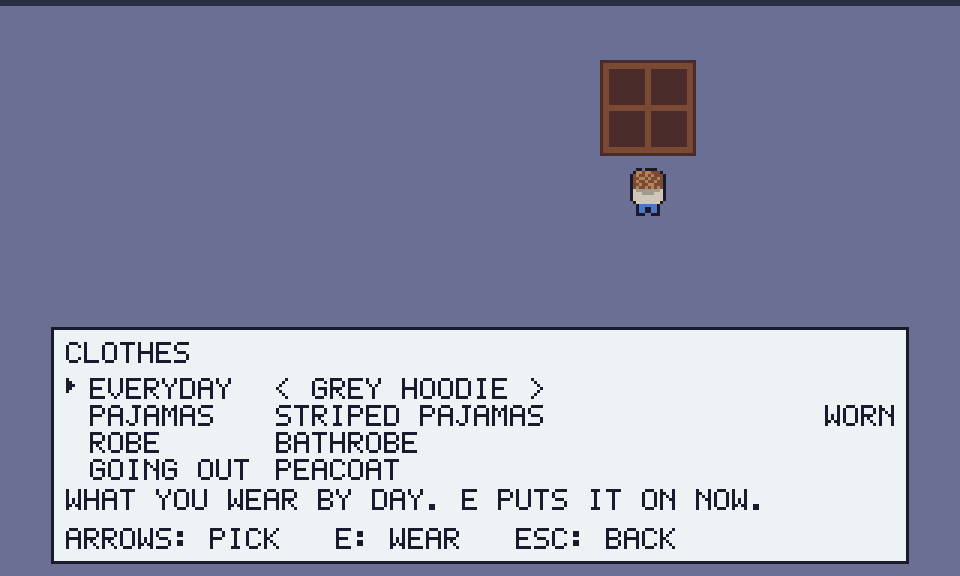
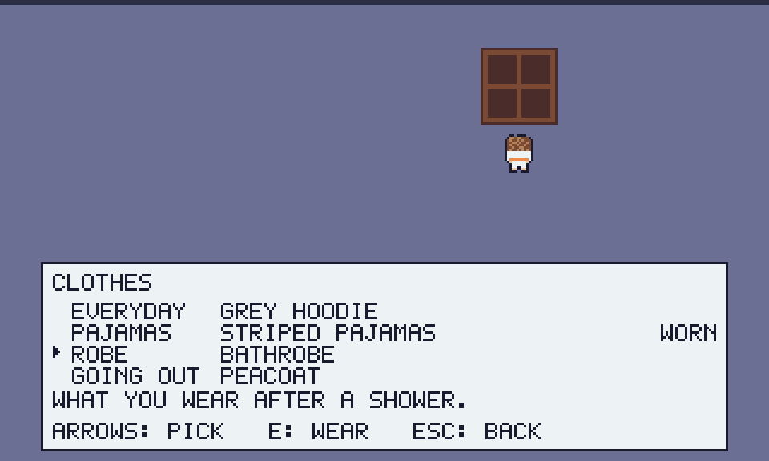
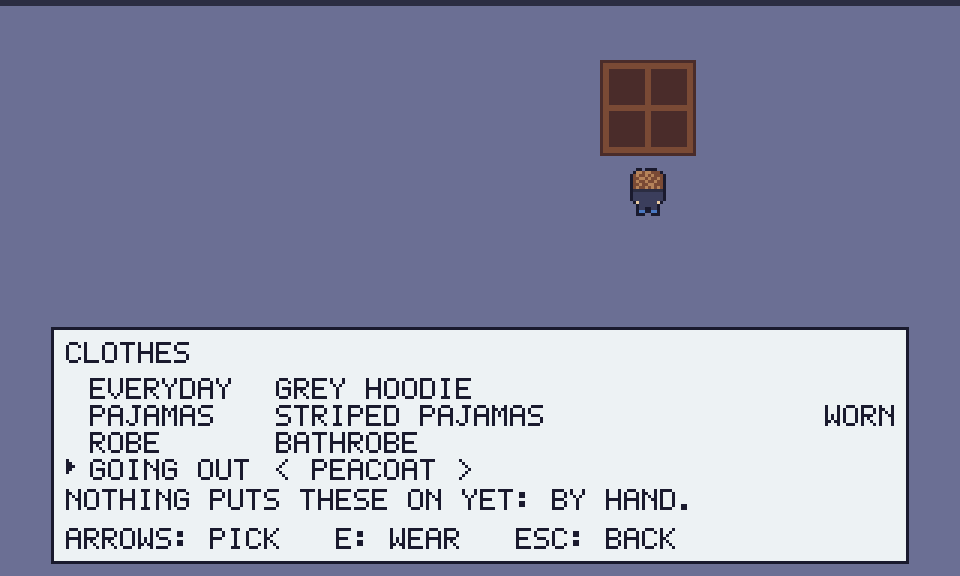
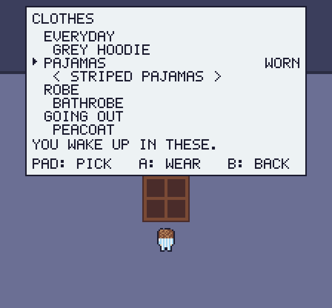

# Outfit slots that change by occasion (design note, issue 164)

Status: reviewed design; Marc answered d1 to d8 on 2026-11-24 (see the issue). Nothing is built. Marc's answers that shaped this revision: **returning to everyday is only by hand (no timer)**, **strict by style** (each slot takes only its own style), no text or sound on an automatic change, a manual change sticks until the next occasion, a nap changes nothing. Marc's idea (2026-11-24): materia-like slots; you equip an outfit into a slot, and on the matching occasion your clothes change to that slot's outfit. Builds on issues 152 (worn outfit), 156 (outfits as data), 158/159 (generator and outfits) and 150 (poses). Idea notes: [ideas.md](ideas.md) 'Outfit slots that change by occasion' and 'Put on the robe after a shower'.

## In short
- Four slots: EVERYDAY, PAJAMAS, ROBE, GOING OUT. Each holds one outfit you own, and only one of its own style. They are only a preference list; what you wear is still the decor slot `worn`, so drawing, poses and `syncOutfit` do not change.
- Two occasions fire today: finishing the sleep task puts you in the PAJAMAS slot, finishing the shower task puts you in the ROBE slot. Nothing else changes your clothes by itself: **there is no timer**, so you stay in pajamas or the robe until you change at the bookshelf. GOING OUT has no occasion yet.
- The Change clothes list at the cube bookshelf becomes a list of the slots. Up and down choose a slot; left and right change which outfit is equipped in it (you see it on yourself at once); E wears that slot now.
- Issue 165 (the shower scene, an in-room scene in the bath: Marc's answer to its d1) gets the robe from this: the shower task completing fires the ROBE occasion (`taskComplete` for id `shower`), and the player "appears" outside the tub in it (see 'The hook for issue 165').

## 1. What the code does today (checked)
Line numbers are for `main` at 055f688.

| Claim | Where |
|---|---|
| What you wear is the item in decor slot `worn`; the state variable `outfit` is derived from it every frame and no task writes it. | `Game.syncOutfit`, `game.ts:486`; called from `update` (740, 787) and `tickClock` (822) |
| `worn` is an off-map decor slot, kind `outfit`, default `outfit-home`, on the cube bookshelf; it cannot be empty (it has a default). | `decor-data.ts:141` |
| `syncOutfit` reads `decor.shownIn("worn")`, which includes a swap preview, so the clothes list previews the outfit on you. | `decor.ts:175` |
| An outfit is `{id, name, style, prefix}`; `style` is `home`, `casual`, `out` or `pajamas` and nothing but tests reads it (`outfitStyle` has no other caller); the item is `outfit-<id>`; the `outfit` number is an index into `OUTFITS`. | `outfits.ts`, `outfits.test.ts` |
| The robe is `pajamas-robe` (style `pajamas`); its gift arrives on day 72, striped pajamas on 69, the plain pajamas on 45. | `outfits.ts`, `delivery-checkpoints.ts:37,45,46` |
| "Change clothes" is the generated task `swap-worn`, using the activity `swap-decor`. It is offered only when an owned outfit is not worn (`Decor.canChange`), so a fresh game has no prompt. | `tasks.ts:372`, `decor.ts:352`, `game.ts:244` |
| The list is one flat list of fitting owned outfits; up and down move and preview, E places, Esc leaves. It holds the clock and ends quietly. Left and right are unused. | `activities/swap-decor.ts` |
| Task completion order: `finish` applies the task's effects (`applyEffects`, 321), then scores, then calls `onComplete` (346), which in `Game` shows the popup, emits `taskComplete` and may start an ad encounter (`maybeEncounter`, 230). A cancel (Esc) returns before any of that, so a cancelled sleep changes nothing. | `interaction.ts:297-346`, `game.ts:197-231` |
| `nap` is the sofa pose `sit-sofa` (clothed); `sleep` is the pose `sleep-bed` with `clothed: false`; `shower` has no pose and no activity (a plain timed task, 6 seconds). | `tasks.ts:200,310,304,90`, `poses.ts:66` |
| Sleep and nap skip the clock with the effect `clock` (`wake` or `add`). `State.applyEffects` calls `onClockSkip`, which `Game` wires to `deliveries.advance`. The monotonic total `deliveries.hours` counts ticking and skipped hours; it is saved. | `state.ts:124-146`, `game.ts:190`, `deliveries.ts:131` |
| The sleep activity changes no state; its scene is read from the running activity and it holds the clock (`holdsClock`). The pose picked at task start is the worn outfit's (`outfitPoseSprite`), so nothing flips when a pose starts. | `activities/sleep.ts`, `game.ts:233-238` |
| The game clock ticks 2 game minutes per real second, so two game hours are 60 real seconds. | `config.ts:97` (`CLOCK.minutesPerSecond`) |
| The decor save is `{ owned, placed, seen? }`. `placed.worn` is the worn outfit when it is not the default. `parseDecor` never throws and repairs. `Decor.load/toJSON` are wired in the achievements feature; the sync merge rebuilds the decor object field by field, so an unknown new field is dropped by sync. | `decor.ts:468-535`, `achievements/feature.ts:186,254,277`, `sync/merge.ts:148,197,238` |
| Phones use `NARROW_VIEW` 224 x 208; desktop is 320 x 192. The touch layer has a pad with four directions, A, B and CHOICE, so left and right are available. The hint line shows `PAD`, `A`, `B` on touch (`hintLine`, `ARROWS` becomes `PAD`). The swap list has no tap targets today. | `config.ts:6-12`, `render/hints.ts` |
| THINGS shows `where` as the decor slot's `where` text (`WORN`) or `IN THE INVENTORY`. | `decor.ts:233-256` |

## 2. Slots and what fits
Slots are data in `outfits.ts` (or a new `outfit-slots.ts`), not decor slots:

| Slot id | Name shown | Occasion | Styles it takes |
|---|---|---|---|
| `everyday` | EVERYDAY | the fallback for an empty slot | styles home, casual |
| `pajamas` | PAJAMAS | finishing the sleep task | style pajamas |
| `robe` | ROBE | finishing the shower task | style robe (the bathrobe) |
| `out` | GOING OUT | none yet (reserved) | style out |

**Strict by style (d5).** Each slot takes only the outfits of its own style; there is no `fits` list, because the style already says it (the style data of issue 156 is enough, and `outfits.ts` gets one small table):

```ts
SLOT_STYLES = { everyday: ["home", "casual"], pajamas: ["pajamas"], robe: ["robe"], out: ["out"] }
```
- A new style, `robe`, exists for the bathrobe. Today `pajamas-robe` has style `pajamas` (`outfits.ts`); its line changes to `style: "robe"`. This touches nothing saved: the worn outfit is saved as an item id and the `outfit` number is an index, neither reads the style (`outfitStyle` has no caller outside tests). The generator (`art/outfits.json`, `scripts/outfits.mjs`) does not read style at all, so no art or sprite changes. The existing pajamas outfits (plain and striped) stay `pajamas` and cannot go in ROBE. Tests to adjust: `outfits.test.ts` lists the allowed styles (`["home","casual","out","pajamas"]`) and the keys of an outfit; add `robe`.
- Every style belongs to exactly one slot, so each outfit has exactly one place it can be equipped. That makes "which slot am I wearing" derivable from `worn` alone (the slot whose equipped outfit is the one worn), and is why section 3 saves nothing about it.
- Auto-fill (d4) picks the first owned outfit of the slot's styles in `OUTFITS` order.
- A new test fails if an outfit's style is in no slot's list (the same way the pose test fails for an outfit with no pose sprites). A future outfit with a new style must be given a slot or its own.
- Until the bathrobe is owned (day 72), ROBE is empty and the shower falls back to EVERYDAY (d4). The other slots fill as gifts arrive (pajamas day 45, out day 42, casual day 39).

Style stays only an attribute for drawing; nothing ranks outfits.

## 3. Saved data
Only one thing must be saved: which outfit is equipped per slot. `worn` stays in `decor.placed` as today.

```
decor: {
  owned, placed, seen?,
  outfits?: { equipped: { everyday?: "outfit-casual-hoodie", pajamas?: "...", robe?: "...", out?: "..." } }
}
```
- Optional and left out when no slot is filled, like `seen`, so a save without it reads exactly as today. There is no `returnAt` and no `wearing`: there is no timer, and the slot being worn is derived (section 2).
- `parseDecor` repairs it: only known slot ids; an equipped item must be owned, known, an outfit and of a style the slot takes, else it is dropped (and auto-fill refills it).
- No `outfits` field (an old save): EVERYDAY is seeded with the outfit worn now if its style fits EVERYDAY, else `outfit-home`; the other slots auto-fill (d4). So a player in a hoodie is still in the hoodie after the update; the first sleep puts them in pajamas, which is the feature.
- Sync (`sync/merge.ts`): three places copy the decor fields by hand (148, 197, 238). The new field must be added to the normaliser, to `worldText` (so a tie is judged on it) and to the merge (taken whole from the winner, like `placed`; `owned` is a union so every equipped id stays owned). Without this change the field is silently lost on the first sync, which is the main trap of stage 1; a test round-trips it through `normaliseProgress` and `mergeSaves`.
- Caps: four slots, ids at most `DECOR.maxIdLength`; nothing grows.

## 4. Behaviour
**Wear a slot** (`wearSlot(slot)`): the item is `equipped[slot]`; if the slot is empty, it is `equipped.everyday` (d4's fallback), else `outfit-home`. It calls `decor.place("worn", item)` (so the existing plan, save hook and `syncOutfit` do the rest). The same function serves E in the list and an occasion.

**Equip a slot** (left and right in the list): cycles through the owned outfits of the slot's styles, sets `equipped[slot]`, saves through `Decor.onChange`, and previews the outfit on you. It does not change what you wear, unless the slot is the one you have on, in which case `worn` follows at once (what you see in the slot is what you have on).

**Auto-fill (d4)**: whenever an outfit is owned and a slot is empty, the first owned outfit of the slot's styles in `OUTFITS` order goes in. It runs after `Decor.load` and after `Decor.own` (a gift arriving), never replaces something equipped. So the robe goes into ROBE the day it arrives and nothing needs doing by hand.

**Manual versus automatic (d2, d7).** An occasion changes your clothes; a manual change (E in the list) sticks. Because nothing else is automatic (no timer), the clothes you have on only change when you finish a sleep (to PAJAMAS), finish a shower (to ROBE), or change at the bookshelf. A new occasion always wins over what you put on by hand, because it is the thing you just did. Waking up, then, leaves you in pajamas until you choose otherwise, and so does the robe: that is Marc's choice, and the bookshelf is how you get dressed.

**Empty slot**: an occasion whose slot is empty (a shower before the robe is owned) puts you in the EVERYDAY slot's outfit (d4's fallback): if you were in pajamas you are dressed; if you were already in it nothing changes. Wearing an empty slot by hand does the same.

## 5. Occasions: what exists and exactly where to hook
There are no events for "woke up" or "had a shower"; both are task completions. The hook is one place:

```ts
// in the Game constructor, beside the interaction system's onComplete (game.ts ~197-231)
this.events.on("taskComplete", ({ item }) => this.occasion(item.id));
```
with `OUTFIT_OCCASIONS = { sleep: "pajamas", shower: "robe" }` as a data table in `config.ts` (rules in data, per PLAN.md). `taskComplete` is emitted after the task's effects (clock jump included), and a cancelled task never reaches it. (`InteractionSystem.award`, `interaction.ts:253-263`, the track editor's save reward, also calls `onComplete` and so emits `taskComplete` while a task is still running; it can never carry the id `sleep` or `shower`, and the busy gate would defer it anyway.) So:

| Occasion | Detected by | Change |
|---|---|---|
| Wake up | `taskComplete` for `sleep` (the pose is `clothed: false`, so the picture does not flip; the sleeper just stands up in pajamas) | `wearSlot("pajamas")` |
| Shower | `taskComplete` for `shower` | `wearSlot("robe")` |
| Nap | `taskComplete` for `nap` | none (d8). The sofa pose is clothed, so it uses whatever you wear. With no timer, the hour the nap skips (`NAP.hours`) has nothing to shift |
| Escape from sleep or a shower | no event | none |
| Going out | nothing exists yet (no front door) | the GOING OUT slot is wearable by hand only |

**An automatic change never interrupts a task.** The listener does not change clothes directly. It sets `pendingOccasion`; `update` applies it only when `interaction.active` is null, no dialog is open, and the player is not in a pose. In the sleep case that is the same frame (the activity has ended before `onComplete` is called), unless an ad encounter started in `maybeEncounter`, in which case it waits for the card to end. There is no clock-driven change, so nothing can fire during the sleep scene's held clock.

### The hook for issue 165 (shower scene)
Issue 165's scene is an in-room scene in the bath (Marc's answer to its d1: the player stays in the tub with effects drawn over it), played while the `shower` task runs. What it needs from this issue is one fact: **when the `shower` task completes, the ROBE occasion fires and the player is in the robe slot's outfit (or EVERYDAY if ROBE is empty) as soon as no task is running.** At that moment the in-tub picture is gone (the task has ended) and the player "appears" outside the tub in the robe. So 165 does not draw the robe itself and does not write `worn`; it only has to keep the task id `shower`. Two points for 165:
- `occasion()` is always deferred until no task is running (the gate above), so it cannot be used to change clothes in the middle of the scene. If 165 wants the robe visible on a last scripted frame (stepping out), it draws that frame from the robe's sprites itself and must not assume the robe is owned: ask `outfitSlots.resolve("robe")` for the outfit that will be worn.
- If 165 splits the shower into more than one task, name the one that ends the scene in `OUTFIT_OCCASIONS`. Escape in the scene is a cancel: no `taskComplete`, no change of clothes (the player was never in different clothes, the in-tub picture has none).

## 6. The Change clothes UI
Same task (`swap-worn`), same bookshelf, same box (margin 17, padding 5, row 9 px, ink border, paper fill), a new activity `outfit-slots` (a sibling of `swap-decor`, which stays for every other slot). It holds the clock, pays nothing, has no cooldown and ends quietly, like every swap.

Keys: UP and DOWN choose a slot. LEFT and RIGHT change the equipped outfit (they wrap, the arrows `< >` show only when the slot has more than one owned outfit of its styles (ROBE has one: no arrows)). E wears the highlighted slot now and closes. Esc closes and leaves what you wear as it was; equipment changes already made stay (they are tidying, not a purchase). The room behind previews the outfit on you, as today (the preview is `Decor.preview("worn", ...)`). The tag `WORN` marks the slot you have on. The line above the keys says what the slot is for and, when E would do something, what; it never says "better".

Mockups, rendered with the game's own 5x7 font and palette (three times life size), 320 x 192:





The room is a flat stand-in (the real room cannot be rendered outside a browser); the player is the real sprite in the previewed outfit, the box is laid out with the real glyphs and the real constants. The same layout as ASCII (one char is about 6 px):

```
+--------------------------------------------------------------+
| CLOTHES                                                      |
| > EVERYDAY   < GREY HOODIE >                                 |
|   PAJAMAS    STRIPED PAJAMAS                          WORN   |
|   ROBE       BATHROBE                                        |
|   GOING OUT  PEACOAT                                         |
| WHAT YOU WEAR BY DAY. E PUTS IT ON NOW.                      |
| ARROWS: PICK   E: WEAR   ESC: BACK                           |
+--------------------------------------------------------------+
```
Line notes by slot: EVERYDAY "WHAT YOU WEAR BY DAY"; PAJAMAS "YOU WAKE UP IN THESE"; ROBE "WHAT YOU WEAR AFTER A SHOWER"; GOING OUT "NOTHING PUTS THESE ON YET: BY HAND". All four rows always show (d9). Empty slot row: the name column reads `(EVERYDAY)` and the line says "EMPTY: YOU WEAR YOUR EVERYDAY CLOTHES". The footer is 34 characters (203 px) against 276 available. The first key of the footer is `ARROWS`, which `hintLine` turns into `PAD` on touch.

**Phone** (`NARROW_VIEW` 224 x 208; inner width is 180 px, about 30 characters). A slot name and an outfit name do not fit in one row ("DENIM JACKET AND TEE" alone is 119 px), so on a narrow screen each slot takes two rows: the slot and `WORN` on the first, the outfit on the second, indented. The box is 115 px high; it goes along the top when the player is in the lower half of the screen and along the bottom otherwise (the old swap box chooses from the slot's map `area`, which for `worn` is 0,0 and so always puts it at the bottom, possibly over the player: the new activity must choose from the player's screen rectangle instead).



The touch footer is `PAD: PICK   A: WEAR   B: BACK` (29 characters, fits). The d-pad has left and right. Tapping rows is not built for any swap list and is not part of this issue.

## 7. THINGS page and poses
- THINGS (the inventory page) keeps its `where` text from the decor slot. An outfit equipped but not worn would read `IN THE INVENTORY`, which is true and tolerable; an optional small change in `Decor.entries` (stage 1b) could say `IN THE ROBE SLOT`. Not required.
- Poses follow the worn outfit, picked once when a task starts (issue 150), and an occasion cannot change `worn` while a task runs (the gate above), so a pose never flips. The sleep pose shows no clothes. The wake change happens after the sleep pose ends; at that moment the standing sprite is already the pajamas.

## 8. What could go wrong
1. **An automatic change during a task.** Guarded by `pendingOccasion` plus the free-player check; a test starts a task, fires an occasion, asserts `worn` is unchanged, ends the task, asserts it changed. An encounter that starts right after `taskComplete` (`maybeEncounter`) is another "busy" case and is covered by the same check.
2. **The sleep scene.** Finishing the sleep task fires the occasion; Escape in the scene fires nothing (the cancel path returns first, `interaction.ts:309-313`), so you never wake in pajamas after backing out. The effects and the occasion are two separate writes: if the tab is closed between the autosave of one and the other you wake in yesterday's clothes, once. Harmless and not repaired.
3. **A nap.** Changes no clothes (d8) and uses the worn outfit's sofa pose. If Marc wants naps to change clothes, the pose is re-picked at task start, so it would work.
4. **Loading a save mid-pose.** Tasks are not saved, so a loaded game starts with the player free; `worn` comes back from `placed.worn` and `syncOutfit` brings the sprite in step. A "SYNC NOW" from the pause screen during a task applies another device's decor while the pose sprite chosen at task start stays; the task ends in the other outfit with no flip during the pose (existing behaviour, not made worse). A save whose equipped outfit is no longer owned or no longer of the slot's style loses just that entry on load and auto-fill refills it.
5. **Sync drops the new field** if `sync/merge.ts` is not updated (section 3). The highest risk because it is silent.
6. **Stuck in pajamas or the robe.** With no timer (Marc's d2), after waking or a shower you stay in them until you change at the bookshelf, even through the day's tasks and walking about. The design does not soften this; it is the choice. The cost is one trip to the bookshelf.
7. **A gift arrives while you wear the slot's old outfit.** Auto-fill only fills empty slots; it never swaps what is equipped or what you have on.
8. **The style rename.** Moving the bathrobe from style `pajamas` to `robe` is safe (nothing saved or drawn reads the style), but a test that lists styles must be updated, and a later outfit of a new style needs a slot.
9. **A new outfit whose style has no slot.** A test fails (section 2), the same way the pose test fails for an outfit without pose sprites.
10. **Quiet collecting.** No outfit is better, nothing is required, no number, count or "complete the set": a slot can stay empty forever and the game falls back to everyday. Slots hold outfits you already own; nothing is gated behind a slot or an occasion. The automatic changes make no sound and show no text (d6); they are a picture of what you just did. The fresh game is unchanged (one outfit owned, no pajamas, no robe: every occasion resolves to the outfit already on), and the golden frames do not change.

## 9. Build plan
Stage 1 is useful by itself (slots, equip, wear by hand), stage 2 adds the two occasions. Simpler than the first plan: no `fits` list, no timer, no `wearing` or `returnAt` in the save. Each stage is a branch and an independent review.

| Stage | What | Size |
|---|---|---|
| 1a. Data and save | the `robe` style and `SLOT_STYLES` in `outfits.ts` (the bathrobe's line changes style); a pure module `outfit-slots.ts` (resolve, auto-fill, wear, parse and repair); the `outfits` field in `DecorSave`, `parseDecor`, `Decor.load/toJSON`; the three places in `sync/merge.ts`; tests (old save, repair, sync round trip, every style has a slot). No visible change. | about 150 lines of code, 200 of tests |
| 1b. The list | The `outfit-slots` activity (draw, keys, preview, narrow layout), the `swap-worn` task using it, the box position from the player's rectangle; tests like `swap-decor`'s; a mockup check by rendering. | about 220 lines, 150 of tests |
| 2. Occasions | `OUTFIT_OCCASIONS` in `config.ts`; the `taskComplete` listener and `pendingOccasion` applied when free; tests (sleep, shower, Esc, nap, busy gate, encounter, empty ROBE). | about 50 lines, 100 of tests |
| 3. Going out | Blocked until there is a way to go out (a front door). It is one entry in `OUTFIT_OCCASIONS`. | tiny |
| Optional | THINGS `IN THE ROBE SLOT` text. | under 20 lines |

About 420 lines of code and 450 of tests in all (down from about 560 and 550).

Docs to update when built: [decor.md](decor.md) ('What issue 164 built'), [sleep.md](sleep.md) (the player is put in pajamas on waking), [ideas.md](ideas.md) (remove the two idea entries), and the comment at the top of `outfits.ts` (styles now decide slots).

## 10. Questions
Marc answered d1 to d8 (2026-11-24); this note follows the answers. One new question is in the issue with a recommended default:
- d9: whether the list always shows all four slots (recommended: yes; an empty slot reads `(EVERYDAY)` and, for GOING OUT, "BY HAND").
