# Plant pots: three on the bookshelf, each for its own kind of plant (design, issue 179)

Status: design for Marc to confirm (2026-11-24). Marc has answered d1 (the recommended split), d2 (sill and floor as recommended, both later) and d3 (houseplants live, dried arrangements still, the bowl's low plants live but very slow and easy, a mist now and then, never punished); this note follows those answers and asks d4 to d10. Nothing is built; `src/` and `art/` are untouched. The only new files are this note and `plant-pots-mockups/` (the pictures and the small script that draws them). It supersedes issue 170 (the empty pot) and shapes issue 171 (cut flowers), issue 169 (the wall shelf and the sill) and issue 163 (the item pool). It follows [decor.md](decor.md), [decor-expansion-design.md](decor-expansion-design.md) (sections 1, 2 and 9), [art-style.md](art-style.md) and [floor-plan.md](floor-plan.md).

## The design in a few lines
- **Three pots on the cube bookshelf, north to south: a vase, a bowl and the plant pot.** The first two are already drawn into the bookshelf sprite (the vase with its pastel sprays, the white bowl); only the plant pot is a slot today. They become slots. A fresh game looks the same as today (a dried arrangement in the vase, an empty bowl, the snake plant), which is exactly the default Marc described.
- **Each pot holds one kind of plant** (a new `plantKind` on items and `plantKinds` on slots): the vase holds **dried arrangements and cut flowers**, the bowl holds **low plants** (moss, succulent, cactus, small bonsai), the plant pot holds **houseplants**. This is d1's recommended split; if Marc picks another, only the data below changes.
- **"Empty" is an item, not a new mechanism:** each pot has an empty-pot item (EMPTY VASE, EMPTY BOWL, EMPTY POT), owned from the start, so no engine for empty slots is needed.
- **Live and still (Marc's d3):** the plant pot is live, the vase holds still items (cut flowers are the one thing that needs a clock there), and the bowl's low plants are live but very slow and easy: a mist now and then, never punished. The bowl ships still first (stage B), becomes live in stage F, and the clock built for cut flowers (stage C) is what makes that cheap.
- **The window sill** takes still dried and low items first (issue 169), live trailing plants and herbs much later. **Floor trees** go in the one real empty square (col 8, row 7, abs 128,112): it is shut in by the lamp table, the record stand and two walls, so a tree there needs no task spot and no walkable change, only a floor slot, a swap task on the record stand and a decision about how tall it is.
- **Build in five releasable stages** (section 10): A the three pots (M), B low plants (S), C cut flowers with the shared clock (M), D sill (issue 169, S) and E the tree square (S). F makes the bowl's low plants live, the slow and easy way (M). A fully general live pot with growth stages is not planned (L).

## 1. What is there today (checked against the code and the sprites)

I looked at the real room and at `art/src/bookshelf.sprite` at 8x (mockup 1 and 2) and read `apartment.ts`, `decor-data.ts`, `decor.ts`, `plant.ts`, `state.ts`, `game.ts` and `tasks.ts`. I also looked at the reference photos; nothing from them is used, copied, named or described here.

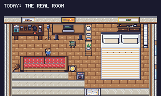

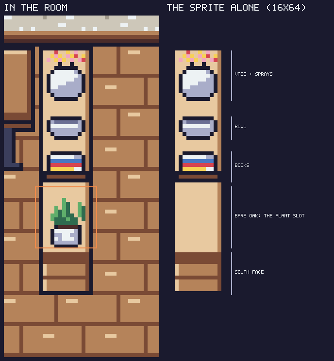

**The bookshelf is a 16x64 piece, `H`, at col 10, rows 1 to 4 (abs x 160, y 16 to 80).** It is drawn from above: the oak top with four things on it, then the shelf's south face. By the sprite's own rows (row 0 is y 16):

| Rows | Abs y | What | Baked into the sprite or an overlay |
|---|---|---|---|
| 1 to 13 | 17 to 29 | a round white vase with pastel sprays (the baked "dried arrangement"): sprays rows 1 to 4, vase rows 4 to 13 | baked |
| 18 to 23 | 34 to 39 | a white bowl, empty (a dusk hollow, a paper rim) | baked |
| 27 to 34 | 43 to 50 | a stack of books on a wooden tray | baked |
| 36 to 51 | 52 to 67 | bare oak, where the plant slot sits | overlay: the `plant-shelf` slot, 16x16 at abs (160, 52), a `Prop` at (0, 36) on `H` |
| 53 to 63 | 69 to 79 | the south face (three drawer fronts) | baked |

So of the three pots Marc describes, the plant pot is a slot today and the vase and the bowl are pixels. The vase's "dried arrangement" and the bowl's emptiness are what the bookshelf already shows, so the baked picture already matches Marc's default.

**What the engine does today** (so the design does not claim more than exists):
- A slot has one `area`, a list of `kinds` and optionally a `default`; an item fits if its kind is in the slot's kinds, its sprite is the slot's size and (if it names slots) this is one of them (`fits` in `decor.ts`). Item ids must start with their kind (`validateDecorData`), so the many `plant-...` ids cannot be renamed to split kinds without breaking saves: that is why this design adds a field rather than new kinds.
- The one plant slot is `plant-shelf` with `stageVar: "plantStage"`, `growthVar: "plantGrowth"` and `dryVar: "plantDry"`. It holds eight items: four live (snake plant, pothos, monstera, spider plant; `FAMILIES` with stages and `droops`) and four still (`plant-dried`, `plant-pampas`, `plant-lavender`, `plant-eucalyptus`). A still item hides the three plant tasks (`liveSlot`) and freezes the three vars (`Decor.frozenVars`); a live plant swapped for a live plant starts small.
- Late stages overhang the slot (`overhang` in `FAMILIES`, issue 149): the pothos stage 4 hangs down over the south face (the face is y 69 to 79; the vines' last ink is at y 72, 5 rows below the slot) and stage 5 hangs further (last ink y 78) and also has 16 px above (a thin vine across y 36 to 51); the monstera stage 4 has 16 px above (its leaves start at y 44). They are overlays: props are sorted by the bottom of their piece (`bottom: prop.on.bounds.y + prop.on.bounds.h` in `drawWorld`) and drawn after it, in the order of `MAIN_PROPS`.
- The care tasks are hard-wired to one plant (section 5). The swap task is one per slot that names an `object` (`swap-plant-shelf` on the cube bookshelf, shown only when something spare fits); `SWAP_PROMPT_SLOT` in `tasks.ts` already lets a slot have its own prompt.
- A slot may have no default (issue 151: it starts empty, with a NOTHING row in the swap list) but a slot with a default cannot be emptied.

## 2. The three pots

### Where they are (abs pixels in the room, 16x16 each)

| Pot | Slot id (proposed) | Area (x, y, w, h) | Sprite rows | What it holds |
|---|---|---|---|---|
| 1. vase (north) | `pot-vase` | 160, 16, 16x16 | 0 to 15 | dried arrangements and cut flowers |
| 2. bowl (middle) | `pot-bowl` | 160, 30, 16x16 | 14 to 29 | low plants |
| 3. plant pot (south) | `plant-shelf` (id kept, so saves stay valid) | 160, 52, 16x16 | 36 to 51 | houseplants |

The vase and bowl slots share two rows (y 30 and 31): nothing is drawn there by either, and nothing in the engine forbids touching areas (only a prop's own area must equal its slot's, `checkLevel`). The books (rows 27 to 34) stay baked into the bookshelf; the bowl slot's last rows lie over them, but items are transparent there, so the books show. A bowl slot at y 32 (rows 16 to 31) would not touch the vase slot, but the baked bowl (rows 18 to 23) would then leave only 2 rows above its rim; y 30 with the bowl 2 px lower (d6) gives 4 rows, at the price of the two touching rows.

Which pot is which, and why: the vase is tall and narrow, so it takes the arrangement that stands tall (dried stems, tulips). The bowl is wide and low, so it takes things that sit low (moss, succulents, a bonsai). The plant pot is the one that already grows and is watered. North to south is also the order the room already reads, and it is the order of d1's recommendation.

### The default room, and what each pot looks like empty

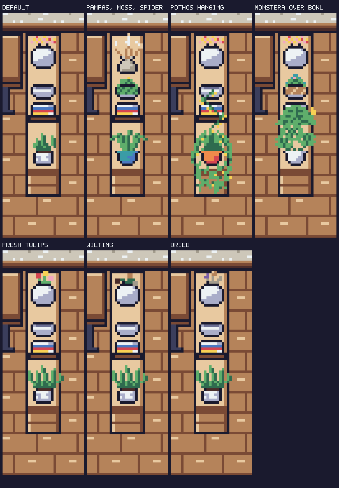

- **Default (first panel):** the vase holds `plant-vase-dried`, a new still item whose art is the baked vase and sprays moved out of the bookshelf sprite; the bowl holds `plant-bowl-empty`, the baked bowl moved out; the plant pot holds the snake plant. The three pieces are cut from the real sprite pixel for pixel (the mockups do exactly that), so the room is the same picture with one exception: **the bowl item is drawn 2 px lower than the baked bowl** (decision d6). Reason: existing vase items (pampas, lavender, eucalyptus) put their base line on slot row 15 (y 31), and the baked bowl's headroom starts at y 30, so a low plant above the rim would touch them; two pixels lower gives 4 clear rows (y 32 to 35) for a plant. Without the nudge the fresh room is identical pixel for pixel but a moss or a bonsai has 2 rows.
- **Empty states** are ordinary still items that fit only their pot: `plant-vase-empty` (the baked vase with the sprays removed), `plant-bowl-empty`, `plant-pot-empty` (the snake plant's pot with soil and no leaves; this is issue 170's "empty pot"). All three are `how: "start"`, so every save owns them (`parseDecor` seeds them) and any pot can be emptied again by choosing its empty item. The three new entries on the THINGS page read "ALREADY HERE", like the lamp. No new engine is needed (d5 asks if Marc prefers an empty slot instead).
- **How the baked art becomes slot art:** `bookshelf.sprite` is redrawn with bare oak where the vase, its sprays and the bowl were (rows 1 to 13 and 18 to 23; `art.shelfBare` in the mockups is that sprite). The cut-out pieces become the sprites of the three default items. The books, tray and south face do not change.

### Swap tasks and where you stand

All three pots are on the one object, the cube bookshelf, so all their tasks come from the same place; you can face it from any of its tiles: col 9 rows 3 and 4 (facing east), col 11 rows 1 to 4 (facing west) or col 10 row 5 (facing north). I checked these on the map; the other sides are the desk and walls. Pothos vines (stage 5) reach y 79 and the floor tile at col 10, row 5 stays clear, as issue 149 checked.

- Tasks: `swap-plant-shelf` (exists), `swap-pot-vase` and `swap-pot-bowl` (new), each offered only when a spare item fits that pot (`Decor.canChange`). **Careful:** the empty pot, empty vase and empty bowl are owned from the start, so by the existing rule a spare empty pot makes `canChange` true on a fresh game and the bookshelf would show "Change plant" and "Change vase" from day one (not the bowl, whose empty item is the one on show). Fix, S, in stage A: items flagged `empty: true` do not count as spares in `canChange` (they still appear in the list once it is open). Without it the fresh-game swap tests change. Prompts "Change plant", "Change vase" and "Change bowl" come from `SWAP_PROMPT_SLOT`, which already exists for the bed rug. The slots name `object: "cube bookshelf"` and `swapProblems` checks it.
- Crowding: the bookshelf today offers at most 7 things at once (one care task, four record sorts, two swaps: the plant and the clothes); with three pots it is at most 9 (the vase and bowl swaps show only with a real spare, see above). I recommend one swap task per pot (d9 asks if one "Change plants" that picks the pot first is better).
- Task words follow the item (`taskName`): "Water the snake plant" as today.

### Draw order and the tall plants

The three pots are props on `H`, drawn in the order vase, bowl, plant, so the plant (with its overhang) is on top. The pothos still hangs over the south face exactly as built in issue 149 and nothing changes for stages 0 to 4. At stage 5 the thin crawling vine (y 36 to 51) already crossed the baked bowl's lower rows and the books; with the bowl 2 px lower it crosses the bowl's rim and bottom (y 36 to 41) and the books. The monstera's crown starts at y 44, so it clears the bowl (mockup 3, panels 3 and 4). So nothing hides the vase or the bowl, and a vine across the bowl reads as a plant leaning over it (accepted, see the note at the end of section 11).

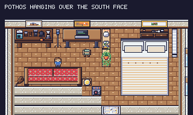

## 3. Plant kinds and which items fit which pot

A new optional `DecorItem.plantKind` (`"house" | "dried" | "low"`, later `"tree"`, `"window"`) and a `DecorSlot.plantKinds` list. In `fits`, if the slot has `plantKinds` and the item has a kind `plant`, its `plantKind` must be in the list; items of other kinds (trinkets) are not affected, so the sill can take plants and trinkets. This is size S. (A data-only start is possible today with the existing `DecorItem.slots` list on every item, but then a low plant that fits both the bowl and the sill must name both, and the swap list cannot say why something does not fit. I recommend the field.)

| Item | Kind | Fits | Live | Exists | Art |
|---|---|---|---|---|---|
| SNAKE PLANT, POTHOS, MONSTERA, SPIDER PLANT | `house` | plant pot | live (stages, droop) | yes | 4 families, done |
| EMPTY POT | `house` | plant pot | still | no | 1 sprite (cut from `plant-0`) |
| DRIED FLOWERS (`plant-dried`), PAMPAS PLUMES, LAVENDER BUNDLE, EUCALYPTUS JAR | `dried` | vase (and the sill) | still | yes | done |
| VASE ARRANGEMENT (the default), EMPTY VASE | `dried` | vase | still | no | 2 sprites (cut from the bookshelf) |
| TULIPS, DAISIES (issue 171, fresh then wilting then dried) | `dried` while dried, see section 4 | vase | clocked | no | 3 looks each |
| EMPTY BOWL | `low` | bowl | still | no | 1 sprite (cut from the bookshelf) |
| MOSS, SUCCULENTS, CACTUS, BONSAI | `low` | bowl (and the sill) | still first, live and slow in stage F (Marc's d3) | no | 4 sprites (and one wilted look each for stage F) |
| FLOOR TREES: potted palm, rubber plant, fiddle-leaf fig | `tree` | floor | still first | no | 3 sprites |

Notes:
- The four existing dried items change pot: today they stand in the plant pot (and freeze its variables); under this design they move to the vase. A save that has one of them in the plant pot is migrated (section 8). Behaviour change to know about: you can no longer park a dried arrangement in the plant pot to pause the snake plant; the empty pot does that (d4).
- The existing TEST plant (`plant-test-grown`) gets `house` so its tests keep passing; it disappears with the other TEST items in stage 4.
- **First art set for the low plants:** four 16x16 sprites, each one still image (no family), each a bowl with the plant, drawn so the bowl's rim and shape match `plant-bowl-empty` (same bowl, a plant in it). The bowl is 8 px wide (x 4 to 11) and 6 px tall, and a plant has 4 clear rows above the rim, so they are genuinely low: a moss mound 3 rows, a succulent rosette cluster 4, a cactus 4, a bonsai canopy 3 rows plus a trunk. Mockup 8 shows rough stand-ins for all four (drawn in code in the game's palette for this review, **not** game art), so Marc can judge the height before anyone draws the real ones.

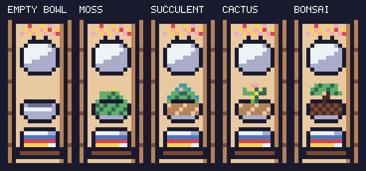

- If Marc prefers d1's second option (flowering plants in the third pot: orchid, African violet, a tulip pot) the bowl list changes to those and the bowl may want 6 clear rows instead of 4, which is the argument for moving the bowl 2 px further down (d6).

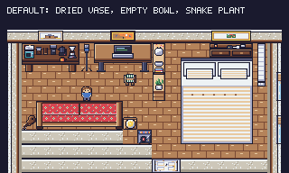

The whole plan at once, stand-ins included (vase arrangement, a bonsai in the bowl, the pothos hanging, lavender on the sill, a tree in the square):

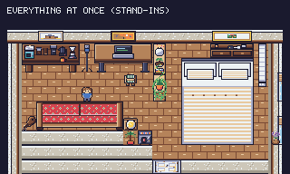

## 4. Cut flowers drying into the vase (issue 171)

Issue 171 wants a family with fresh, wilting and dried looks: fresh until 3 game days, wilting, dried at 5, a free task to freshen them, nothing lost. In this design they live in the vase pot.

(Panels 5 to 7 of mockup 3 are the three looks, stand-ins drawn in code; the vase is the real one.)

- **What the vase needs.** The vase slot gets `stageVar` and `dryVar` of its own (`vaseStage`, `vaseAge`), like the plant pot's, and the flowers family advances `vaseAge` with the clock. This is the "per-slot clock" in section 5, and it is the one new engine piece cut flowers need beyond issue 171's own list (`driesAfter`, state-aware `isLive` and `frozenVars`, a task gate that is not `liveSlot`).
- **How a bunch becomes a dried arrangement.** Two ways; I recommend the first, in place, as Marc's d1 answer says; the second is the alternative (d7).
  1. In place (171 as written): the item stays `plant-tulips`, its look turns to dried after 5 days. A new bunch arriving resets it, so the dried arrangement goes away.
  2. **It turns into a keepsake:** when the bunch dries, the fresh item is replaced by a separate still item (DRIED TULIPS, `dried`, same slot, same place on the shelf) that you keep, and the fresh item is no longer owned, so a new bunch can arrive again (deliveries refuse owned ids, so this is also what makes "several bunches over time" work). Dried arrangements are then collected by drying flowers, or delivered the regular way, as Marc described. It needs a small `Decor.become(slot, from, to)` that swaps an owned id for another in place: S. The keepsake must not join the shop pool (the pool excludes only `how: "start"` and TEST items, so a florist could otherwise sell you a keepsake you made): give keepsakes a `tags: ["keepsake"]` that `itemPool` skips (S). Note Marc's d1 answer says flowers "wilt and dry in place", which is the first way, so the default of d7 follows his words and the keepsake is the alternative. Nothing is lost: the keepsake is an owned item and can be swapped out like any other.
- **Cut flowers in a pot other than the vase?** No: a fresh bunch fits only the vase (it is a `dried`-kind item while it dries). A fresh bunch in the plant pot would need that pot's clock, which is the live work in section 5.

## 5. Live and still, and what the engine needs

**Today the plant care is built for exactly one plant, by name.** Where (all checked in the code):
1. `state.ts` `tick`: `if (this.has("plantDry")) write("plantDry", ... + hours)`.
2. `tasks.ts`: the `nap` task adds `{ var: "plantDry", add: NAP.hours }` and `sleep` has `{ var: "plantDry", addSkipped: true }`.
3. `plant.ts`: `DROOPING`, `THIRSTY`, `WATER_EFFECTS` and `WATER_REQUIRES` are written in `plantDry` and `plantGrowth`, and the three care tasks use them and `liveSlot: "plant-shelf"`.
4. `game.ts` line 578: when `plantGrowth` changes it runs `settlePlant(state, decor.growth("plant-shelf"))`.
5. `particles/feature.ts`: the grow and perk puffs watch `plantStage` and `plantDry` by name.
6. `state-vars.ts` declares the three vars, and the golden frames (`main-room-frames.ts`) set them.

What is already general: `Decor.look`, `growth(slot)`, `isLive(slot)`, `frozenVars()` and `taskName` all work per slot from `stageVar`, `dryVar` and `growthVar`, and `liveSlot` names a slot. So the decor store is ready for a second live pot; the clock, the tasks, the settle and the particles are not.

| Piece | What it takes | Size |
|---|---|---|
| Three pot slots, `plantKind`, empty-pot items, migration | data, `fits`, one `parseDecor` rule, tests, art | M |
| A per-slot clock (`ages: true` on a state variable in `state-vars.ts`; `tick`, `nap` and `sleep` advance every such variable instead of `plantDry` by name) | replaces points 1 and 2 above; the snake plant's behaviour stays the same and a test proves it | S to M |
| Cut flowers on the vase (needs the clock) | issue 171, plus `Decor.become` | M |
| A **live** second pot: its own three vars, its tasks (a `water-bowl` set or one task per slot generated from the slot's vars), `settlePlant` per slot, particles per slot, golden frames, text | points 3 to 6 above, generalised over a table of live slots | L |
| **A live low plant, the slow and easy kind Marc chose in d3** (one clock variable, one "mist" task, never punished, no growth stages) | the clock above, one task offered only when the bowl holds a live item, one extra look per plant; no settle, no growth, no tasks per stage | M |

**What to do first with one live pot and two still pots:** ship the three pots with only the plant pot live (stage A) and change none of the care code. Everything the player sees is new swap lists, new items and the empty pots. The vase and bowl hold still items, which the engine already knows (no tasks, nothing frozen that matters). Then add the clock (stage C, with cut flowers) because it is needed anyway. Then the bowl's slow and easy live plants (stage F, M) cost one variable and one task on top of the clock. A fully general live pot with growth stages (the L piece) stays out: Marc asked for "very slow and easy", and that does not need it.

## 6. The window sill

The lower east window is the `W` piece at col 18, rows 6 and 7 (abs 288, 96, 16x32). It is drawn edge-on: only its east 6 px are glass; the rest shows the wall. Issue 169 proposes the sill as slot `sill-window` at abs (288, 112, 16x16), the lower half of the glass, with its own piece name so it has its own swap task while the blinds keep working from col 17.

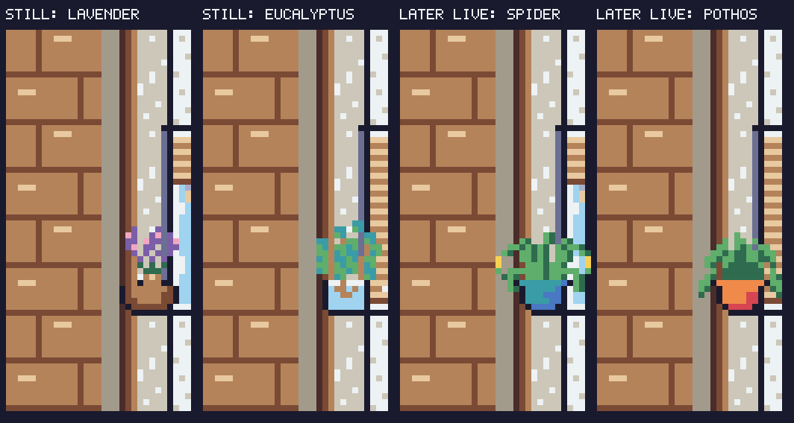

The four panels are real sprites placed on the slot (lavender and eucalyptus are still items; the spider plant and pothos only show how a live one would sit). A 16x16 pot there covers the lower half of the glass; the blinds still show above it.

- **First (issue 169, still only, as answered there):** the sill takes `dried` and `low` plants and trinkets: `plantKinds: ["dried", "low"]` and `kinds: ["plant", "trinket"]`. An item shown on the sill is not in the vase or the bowl (an item is shown in one place), so the sill is a second home for the same stock rather than a new kind of thing: a cactus can move from the bowl to the sill. Nothing new to draw.
- **Eventually:** a `window` kind (trailing plants and small herbs). A trailing plant on a sill hangs over the sill's edge, which wants its own sprites. I would not draw any until the sill is live (an L piece with its own vars, the same work as a live bowl); herbs that need watering belong there.
- Sill and shelf are far apart, so each stays a calm one-slot thing; nothing needs to hold two.

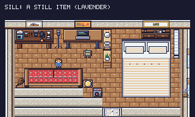

## 7. Trees in the empty square next to the sofa, the lamp and the record player

**Where.** I flood-filled the main map from the start tile: exactly one floor tile cannot be reached, **col 8, row 7, abs (128, 112), 16x16**. It is the square just below the lamp table (col 8, row 6, abs 128,96), just left of the record stand (col 9, row 7), diagonal to the sofa's east end, with the south wall below and the wall under the sofa to its west. It is bare floor (the wood floor is drawn under it) and the player can never stand on it. Mockup 11 and the room at 1x show it. The only other open floor beside the lamp is col 9, row 6 (abs 144,96), which is the walk between the lamp and the door; a tree there would block it, so I do not propose it.

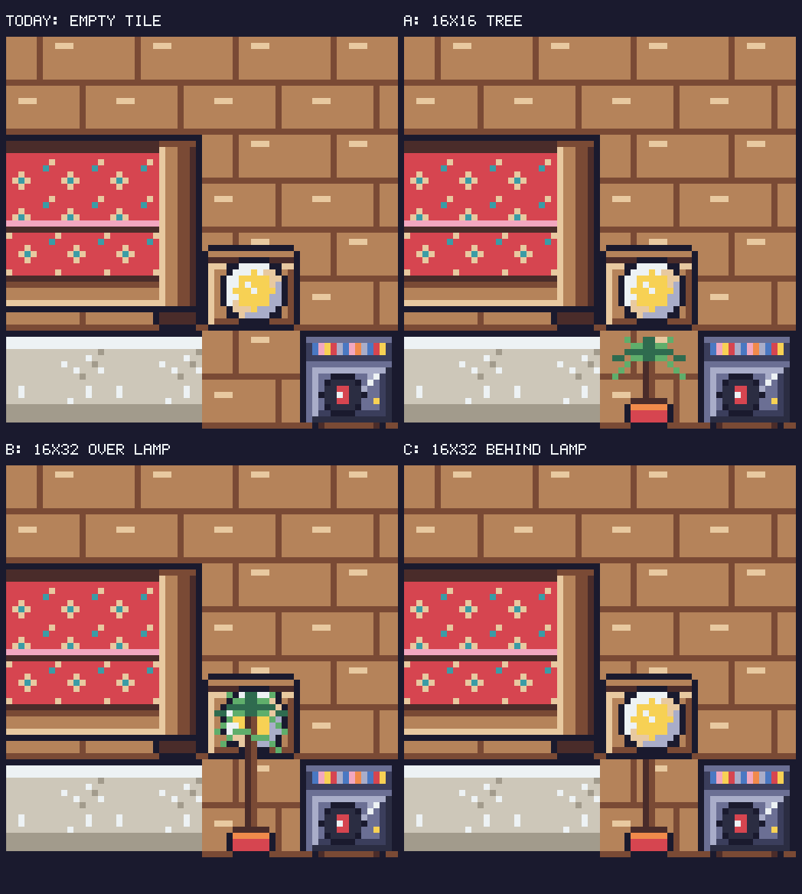

**What a tree there needs.**
- **A floor slot** `tree-floor`, area (128, 112, 16x16), kind `plant`, `plantKinds: ["tree"]`, no default (empty, so a fresh game is unchanged; issue 151's empty slot is enough: the nook stays bare until a tree is owned). It is a prop on the record stand `R` (at (-16, 0) from the stand's corner (144, 112)), so it is sorted by the stand's bottom edge (128): it draws after the lamp table and the sofa (bottom 112) and after the player in any tile above, which is correct for something standing further south. Nothing can overlap it from the player's side, since the tile is shut in.
- **A swap task on the record stand** (`object: "record stand"`, prompt "Change tree"), which is next to it. You stand at col 9 row 6 facing south, or col 10 row 7 facing west (both are open floor). You cannot face the nook itself (its four neighbours are the lamp table, the record stand and two walls), so the task must hang on a neighbour; the lamp table's task is already the lamp swap, so the record stand (which has only `record-play`) is the natural one.
- **No care task and no standing spot** for a still tree. A live tree would be the same L piece as any live pot.

**Height (d8).** A 16x16 slot holds a small tree whose crown is inside the tile (panel A). A taller tree, 16x32 with the crown over the lamp (panel B), covers the lamp completely, because the nook and the lamp are in the same column: the lamp is the light source and a swappable slot, so I do not recommend it. Drawing the tall tree behind the lamp (panel C) leaves only a trunk. A 16x32 tree would also need an `up` for still items (today only family stages overhang, `look` reads `overhang` only for stages), S. So: **16x16 small trees** (a potted palm, a rubber plant, a fiddle-leaf fig, all in a floor pot), 3 sprites. The mockup tree is a stand-in drawn in code.

- The lamp's night glow (radius 40) lights the nook; no change.
- Narrow view (224x208): the camera follows the player along x from 0 to 80; the shelf (x 160) and the nook (x 128 to 144) are in view at every camera position, the sill (x 288 to 304) only at camera x 80. Mockup 7 is the narrow view at camera x 80.

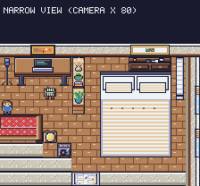

## 8. Saves and migration

- A save with the snake plant in the plant pot is unchanged: `plant-shelf` keeps its id, stage, growth and dryness are untouched, nothing in it is read differently.
- `parseDecor` already seeds `owned` with every slot default and every `how: "start"` item, so an old save simply gains the vase arrangement, the empty vase, the empty bowl and the empty pot. Nobody loses anything and nobody pays.
- A save with a dried item in the plant pot (`placed["plant-shelf"]` is `plant-pampas` and so on): after the split that item no longer fits the plant pot. Without a rule `parseDecor` would drop the placement and the item would go to the inventory. So one rule is added, a small `MOVED` table in the decor data (`from slot`, `plantKind`, `to slot`): if the asked placement for `plant-shelf` is a `dried` item, it is read as a placement for `pot-vase`. The plant pot then shows the snake plant (the default). **Edge:** the three plant variables were frozen while the dried item stood there, at the values of whatever live plant was swapped out. If that was the snake plant, it comes back as it was. If it was a pothos that had grown to stage 5 (the swap resets the variables only when a live plant replaces a live plant, `swap-decor.ts`), the snake plant would show stage 3 (the last stage it has, `look` clamps) and the old dryness. Rule: the migration also resets the three variables to a small plant when the placement it moves was the only reason they were frozen, which cannot be known for an old save; so I recommend simply accepting the clamp (a calm, never-lost outcome) and testing both cases. Size S.
- A save in which both a dried item sat in the plant pot and another was asked for the vase cannot happen (the vase did not exist), but the rule yields to an existing `pot-vase` placement anyway.
- `placed` stores only slots that differ from their default, so the new slots add nothing to a fresh save. The new vars (`vaseStage`, `vaseAge`, stage C) have initial values in `state-vars.ts`, so an old save loads them at their initial values.
- The save has no version bump (as for every decor change so far).
- Golden frames (`main-room-frames.golden.test.ts`): two new props mean two new draw calls and a 2 px lower bowl, so the golden record changes on purpose. Stage A should re-record it and add a check, outside the golden file, that the composed pixels of a fresh room equal today's except the bowl (the mockup script already composes both).

## 9. The item pool (issue 163)

The pool is derived: every item whose kind is in `ENCOUNTERS.pool.kinds` that is not `how: "start"` and not a TEST item. Consequences:
- The new default and empty items are `how: "start"`, so shops never sell them. Good.
- New low plants and trees are `kind: "plant"`, so they join the existing plants shop (`line-plants`) by existing. That shop would then sell trees and bowls and vase flowers at random. Because every item you can be sold must have somewhere to go, **an item must not enter the pool before its slot exists**: tree items ship with the tree slot (stage E), low plants with the bowl slot (stage A or B), never earlier. An item with no slot is still safe (it sits in the inventory) but looks like a dead end.
- Recommend (later, S, stage B or E) an optional `plantKinds` on a product line so shops can specialise: a florist (`dried`, cut flowers), a garden shop (`house`, `low`) and later a nursery (`tree`). A line is one data entry in `encounter-lines.ts`; the draw is unchanged. The kinds are what make this possible, since all of these items have the kind `plant` otherwise.
- The pool weights (10 for unowned, 1 for owned) already make repeats rare as it grows; the new items add about 9 entries (4 low, 2 flowers before they dry, 3 trees, plus more houseplants later).
- Milestone gifts: Marc's rule from 163 stands (a fixed core set trickles, new items join the random pool). A first cactus or moss as a checkpoint gift (say day 40) is a suggestion, not needed.

## 10. Staged build plan (each stage releasable on its own)

Sizes in the convention of the other design notes: S under a day of work, M a few days, L a week or more including art.

| Stage | What | Engine | Art | Size | After it, the game |
|---|---|---|---|---|---|
| A. The three pots | `pot-vase` and `pot-bowl` slots and props, `plantKind`/`plantKinds` in `fits`, the migration rule, three empty items and the default vase item, two swap tasks and prompts, tests, golden re-record, docs/decor.md section | S | 1 edit (bookshelf made bare) and 4 new sprites cut from existing art (vase arrangement, empty vase, empty bowl, empty pot) | M | looks the same (the bowl 2 px lower), the old dried gifts live in the vase, you can empty any pot |
| B. Low plants | the four low plants as items, the `plantKind` shop split (optional), gift days | none | 4 sprites | S | the bowl is worth swapping |
| C. Cut flowers (issue 171) | the per-slot clock (`ages`), `vaseStage`/`vaseAge`, the flowers family, `Decor.become`, the free task | S to M | 6 sprites (two bunches, three looks) | M | flowers wilt and dry into keepsakes |
| D. The sill (issue 169) | `sill-window` takes `dried` and `low` plants and trinkets (169's own slot and piece name) | none beyond 169 | none | S (inside 169) | a second place for the same stock |
| E. The tree square | `tree-floor` slot and prop on the record stand, a swap task on the stand, trees as items | S | 3 sprites | S | a tree beside the lamp |
| F. Live low plants (Marc's d3) | the slow "mist" version on the bowl's clock: one variable, one task, a wilted look, never punished | S to M, uses C's clock | one wilted look per low plant | M | low plants need a mist now and then |
| Later: live sill | the same slow version on the sill, plus trailing and herb sprites (d2) | per-slot variables | new sprites | M to L | when wanted |

Stage F needs stage C's clock and stage B's plants. Dependencies: 169 depends on 167 (the trinket kind); stage D waits for it, but A, B, C and E do not. Stage A does not need 171. Stage C needs A (the vase slot). Nothing here needs the desk slot (167) or the shower scene (177). Files likely to conflict with other branches: `decor-data.ts`, `apartment.ts` (`MAIN_PROPS`, the `H` and `R` entries), `tasks.ts` (`SWAP_PROMPT_SLOT`), `bookshelf.sprite`; 169 and 167 edit the same tables.

## 11. Questions for Marc beyond d1 to d3 (each also an open decision on issue 179)

Defaults are my recommendations; the split in d1 is assumed throughout.
- **d4.** Is the plant pot strictly for houseplants? The existing dried items would move to the vase, and you could no longer park a dried item in the plant pot to pause the snake plant (the empty pot does it). Default: yes, strict.
- **d5.** Are the empty pots real items (EMPTY VASE, EMPTY BOWL, EMPTY POT, owned from the start, three more lines on the THINGS page) or empty slots? Default: items; it needs no engine, and an empty pot is a thing you own, like Marc's real one.
- **d6.** May the bowl sit 2 px lower than the baked bowl (so a fresh game differs from today in 2 pixels, in return for 4 clear rows for low plants instead of 2)? Default: yes.
- **d7.** When cut flowers dry, does the same item just change its look (Marc's d1 wording: they "wilt and dry in place"), or do they become a separate keepsake item (DRIED TULIPS) that you keep, which also lets a new bunch come? Default: in place, as Marc said; the keepsake is the alternative.
- **d8.** The tree square: the shut-in tile at col 8, row 7, and 16x16 small trees (the crown stays inside the tile), rather than a tall tree that hides or sits behind the lamp? Default: yes, 16x16.
- **d9.** One swap task per pot (Change plant, Change vase, Change bowl; each only when there is a spare) or one "Change plants" that asks which pot? Default: one per pot.
- **d10.** Does the sill share the vase's and bowl's stock (it takes `dried` and `low` plants) rather than have a kind of its own? Default: yes, until live sill plants exist.

Not questions but noted: the pothos's stage 5 vine crosses the bowl, as it crosses the baked bowl today (accepted); the four dried gifts and the day each arrives do not change.

## 12. What was and was not checked

Checked: the map, legend and props of `apartment.ts`; the bookshelf rows against the room at 8x; the unreachable tile by flood fill; `fits`, `parseDecor`, `look`, `frozenVars`, `plan`, `swapProblems`, `SWAP_PROMPT_SLOT`, `drawWorld`'s prop order and `PropDef` in the code; the care-code names listed in section 5; the pool in `encounter-draw` by reading. All pictures were rendered from the real sprites and map at 1x then scaled, and looked at by me.

Not checked or only approximated:
- Nothing ran in a browser. The mockups are composed by a script (`plant-pots-mockups/make.mjs`, using `scripts/room-compose.mjs` and the game's glyph table), not by the game; the draw order is the code's rule re-implemented, the camera placement is taken from `render/camera.ts`, and the HUD strip is not drawn.
- The stand-in art (low plants, tulip looks, the tree) is drawn in code only to judge height and placement; none of it is proposed art.
- How three plants feel to look at in a play session, and whether 4 clear rows is enough for a bonsai.
- The reference photos were looked at; nothing from them is used or described here.
- The first reference to "pot 1, 2, 3" in d1 is read as north to south here. If Marc means another order, the slot ids and the default stay but the swap list order changes.

How to re-draw the pictures: `cd ~/Dev/repos/mcordova47/sim-worktrees/179-plant-pots && node docs/plant-pots-mockups/make.mjs`.
