# A Sims-like shower scene that ends in the bathrobe (design note, issue 165)

Status: a design for Marc to confirm. Nothing is built; `src/` and `art/` are untouched. Marc answered all the questions, d1 to d11, on 2026-11-24 (in [issues/165-shower-scene.md](../issues/165-shower-scene.md)): the scene plays **in the bath room itself**, the player stays in the tub with the effects drawn over it (d1), bubbles over the body with the head showing, steam and fog drifting up and droplets falling, all calm and slow (d2), a soft hiss and a quiet click when it stops with the music playing on (d3), and with reduced motion the steam is still and the bubbles do not move (d4). There is no cutscene: the player appears in the tub, and afterwards appears beside it in the robe or in everyday clothes (d5). No skip: Escape pays nothing (d6). Every shower plays the whole scene (d7). No close-up (d8). This note replaces an earlier version that designed a composed close-up (it is in git history on this branch).

It builds on the outfit slots design of issue 164 ([outfit-slots-design.md](outfit-slots-design.md) on the branch `issue/164-outfit-slots`, not merged), where Marc has answered that waking up and a shower change clothes automatically, that returning to everyday is by hand only, and that each slot takes only its own style. Precedents: the sleeping pose (issue 078, [sleep.md](sleep.md)) for a clothes-free pose, the coffee and dish emitters for particles tied to a task.

## In short
- **The shower becomes a pose.** Like sleeping in the bed, `shower` gets `pose: "shower-tub"`: while the task runs the plain player is not drawn and one picture is drawn over the tub, the player standing in it with a heap of soap bubbles from the chin down and the head showing. It is `clothed: false` (like `sleep-bed`), so it is the same for every outfit and nothing flips. The player does not walk anywhere: they "appear" in the tub, and when the task ends they "appear" again on the tile beside it, facing away from the tub (east).
- **The effects are the game's normal particles, in the bath room, over the tub.** Four new particle kinds (droplets, steam, fog, floating bubbles) in `PARTICLES.kinds`, emitted by `PARTICLES.taskEmitters.shower`, drawn by the existing pool. Emitters can already be limited to phases; a small generalisation lets a task have phases (in, water, off) from data.
- **Art: one new sprite**, `player-shower-tub` (16 x 48, palette only, no text), the head and the bubbles at its top.
- **Sound:** a soft hiss while the water runs and a click when it stops. The hiss needs a small engine addition (section 7).
- **Reduced motion:** still steam and fog (a fixed set drawn where moving ones would be), no floating bubbles; the rest is the same.
- **Escape** at any moment: the pose goes, the player is where they were, nothing is paid, no robe.
- **The robe is not this scene's to put on.** The occasion of issue 164 (when the task ends and nothing is active) changes the clothes; the pose draws no clothes, so the player simply appears beside the tub already in the robe if the ROBE slot says so, otherwise in the everyday clothes.
- **Size:** 1 sprite, 4 particle kinds and 4 tiny shapes, about 60 lines of config and 40 of code for the effects, about 100 lines for the sound; three small stages (section 11). Much smaller than the close-up.

## 1. What the code does today (checked)
Line numbers are for `main` at `b1db29a`.

| Claim | Where |
|---|---|
| `shower` is a plain timed task: 6 s, 70 points, effect mood +6, good hours 06:00 to 10:00 and 20:00 to 23:00, default cooldown 10 s. No pose today, so a `WaitActivity`. | `tasks.ts:90,189,349`; `config.ts:69` |
| It is offered at the tub: map letter `U`, 2 x 4 tiles (cols 1-2, rows 1-4) down the west wall of the 9 x 6 bath, so a 32 x 64 piece at pixel (16, 16). It is faced from col 3, rows 1 to 4, looking left; the toilet `Q` and vanity `V` are on the north wall, the door `1` in the east wall at row 3. | `apartment.ts:228-245`; `game.ts:916-922` (`facedPiece`) |
| A task names a `pose` (a key of `POSES`); it plays only at the piece the pose belongs to (`on`), drawn at `at` (pixels from the piece's top-left) with `size`; `replacesPiece` hides the piece's own sprite; `clothed: false` means one picture for every outfit. If the art is missing the plain player is drawn. | `poses.ts:8-39,66-80`; `game.ts:232-238,955-963` |
| While a pose plays the plain player is not drawn; the pose picture is added to the same draw list as the furniture, sorted by the bottom edge (`y + size.h`), and "the sort is stable, so on a tie the player (added last) is in front". The sofa pose sprite is as tall as the sofa for that reason. A pose whose bottom edge is the piece's bottom edge is drawn in front of the piece. | `game.ts:1081-1104`; `poses.ts` (the `sit-sofa` comment) |
| A popup over a player in a pose rises above the pose picture; `playerScreenRect` follows the pose too. When the task ends the plain player is drawn again at the tile they never left. | `game.ts:924-950` |
| The task table pairs tasks with poses (`sleep: { pose: "sleep-bed" }`, `nap`, `doomscroll`...). The pose art is listed for the loader from `POSES` automatically. | `tasks.ts:301-312`; `render/player-sprite.ts:22-25` |
| The camera holds a world smaller than the view still: centred sideways and **at the bottom**, "so the strip above it is free for the HUD". The bath is 144 x 96, so on the desktop (320 x 192) it is at x 88, y 96, and on the phone (224 x 208) at x 40, y 112. The rest of the picture is ink. | `render/camera.ts:70-80`; `game.ts:201,839-846`; `config.ts:6-12` |
| Layers draw in the world pass after the world, the player and the pose, inside the camera's transform; the particle feature is one of them, so particles draw over a pose and are not tinted by the time of day. The HUD and activity pictures come after. | `game.ts:839-859`; `particles/feature.ts:134` |
| Particles: one `ParticlePool` (budget 200), kinds are data (`PARTICLES.kinds`), shapes are `#` grids (`PARTICLE_SHAPES`), unknown ones throw. `PARTICLES.taskEmitters` maps a task id to emitters (`kind`, `every`, `count`, `at`, optional `color` and `phases`) that run while that task runs; anchors are `zone`, `pose`, `piece` (by sprite name) or `player`, in world pixels. A one-shot burst exists only for task completion (confetti). | `config.ts:1415-1424,1426-1470,1468-1498,1546-1562`; `particles/feature.ts:80-90,130-200` |
| An emitter's `phases` is typed `"fall" \| "asleep" \| "wake"` and read from `game.sleepScene?.phase` only; an emitter that stops applying forgets its timer, so it starts with a puff next time it applies. | `config.ts:1455`; `particles/feature.ts:144-146,150-160` |
| Escape cancels a cancellable activity; `finish` with `completed: false` returns before the effects, the score, the cooldown and `onComplete`, so `taskComplete` is never emitted. Completion applies the effects, scores, shows the popup and emits `taskComplete`, then may start an ad encounter. | `interaction.ts:159-160,302-347`; `game.ts:197-231` |
| Reduced motion: read in one place (`reduced-motion.ts`), passed into `Game` and exposed as `Game.reducedMotionAsked` (read every frame by the candle); `ParticlesFeature` has a `game` and can read it. | `reduced-motion.ts`; `game.ts:155`; `time-of-day/feature.ts:151` |
| Sounds: an effect is `{ voices }` in `SOUND.effects`; a noise voice is one 0.5 s buffer played once with an exponentially falling envelope, only formant voices have `hold`, an effect cannot be stopped once scheduled; buses `effects`, `music` and the lazily made `sleep` and `encounter` can be ramped (`rampBus`); `SleepSound` is the model for a sound that follows a running thing and puts everything back when it is gone; mute is the master gain. | `sound/synth.ts:15-18,102,152-165,224-232`; `config.ts:659-667,1127`; `sound/audio-types.ts:48-53`; `sound/sleep-sound.ts` |
| There is no outfit slot code on `main`; `outfitSlots`, the ROBE slot and the occasion exist only in the 164 design. | `grep` over `src/` |
| Sprite sizes are multiples of 16 (except `icon-*`); every sprite file is listed for the loader and `sprite-names.test.ts` fails if one is missing; the player is 16 x 16 and the head is rows 0 to 6 of every standing sprite. | `scripts/sprite-lib.mjs:40-42`; `render/sprite-names.ts`; `art/src/player-idle-down.sprite` |

## 2. The room as the game draws it
The bath is small on screen. The view holds it centred sideways and at the bottom: on the desktop it is the lower middle of the picture (x 88 to 232, y 96 to 192) and on the phone the lower middle of the narrow view (x 40 to 184, y 112 to 208); above it there is ink (the HUD chips sit there). The tub is the 2 x 4 piece at the left of the room; the player stands on col 3 (the tile just east of the tub's curtain strip) and faces it. The scene is drawn **in this room at its normal size**, with no zoom: the pose is 16 x 48 pixels, drawn over the tub (the tub's water is 13 pixels wide, so the head and bubbles are 16 pixels wide at most).

The mockups use the real bath map, the real floor, wall, door, tub, toilet and vanity sprites, the real player and robe sprites and the game's centring. The pose art and the particles are stand-ins (section 13 says how they were made). Not drawn: the HUD chips in the ink strip above, and the popup and confetti at the tub.

Desktop (320 x 192, shown 3 times life size, with a caption strip that is not part of the game):

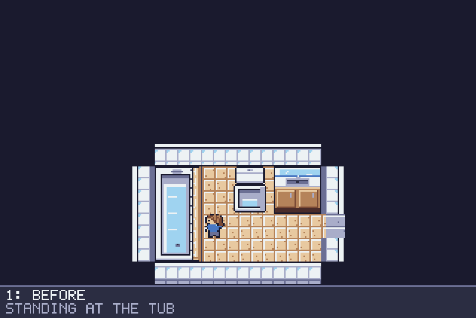
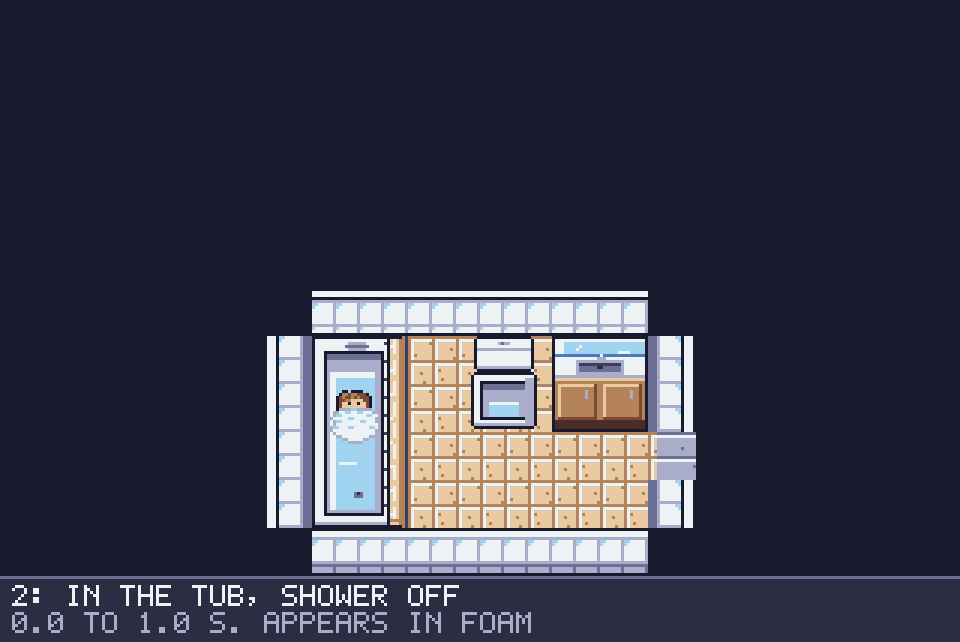
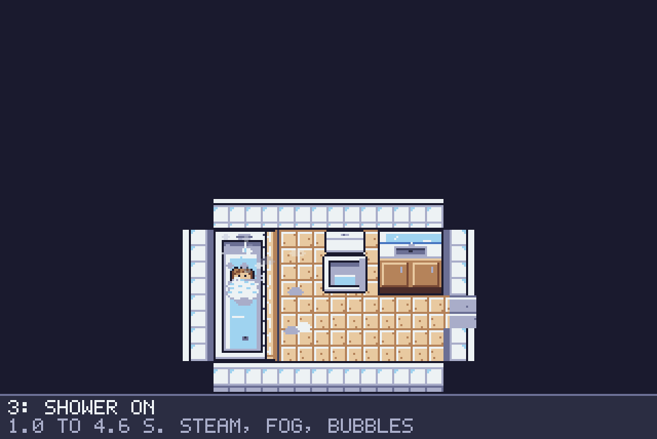
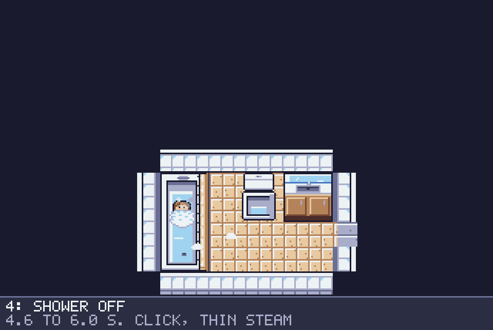
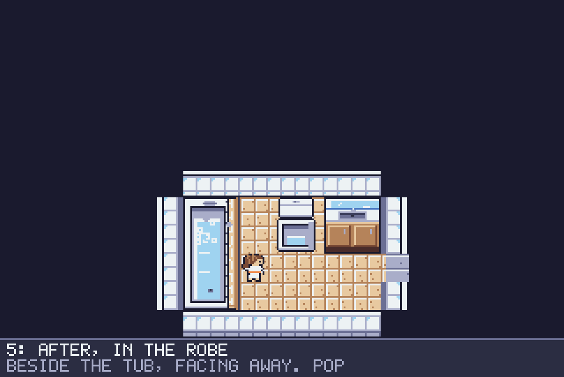

The tub at 6 times, for the effects (2, 3, 4, 5, and 3 with reduced motion):

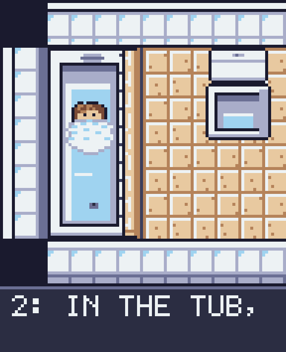

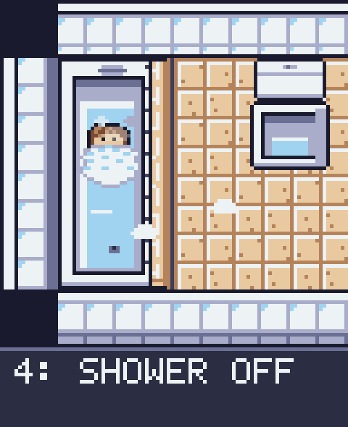
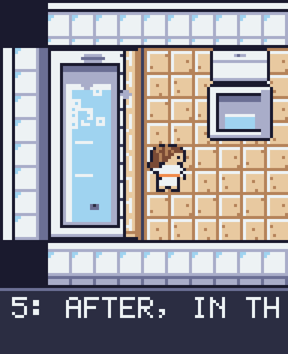
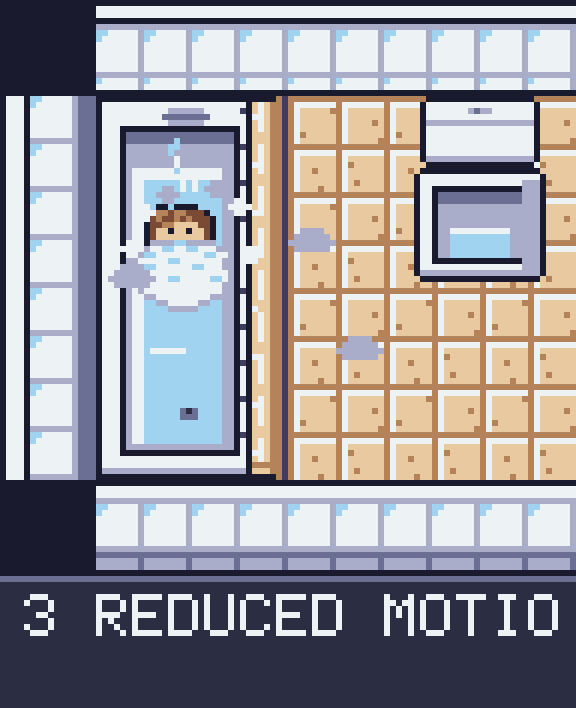

Phone (224 x 208): the same five.

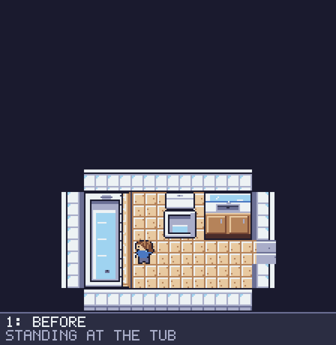
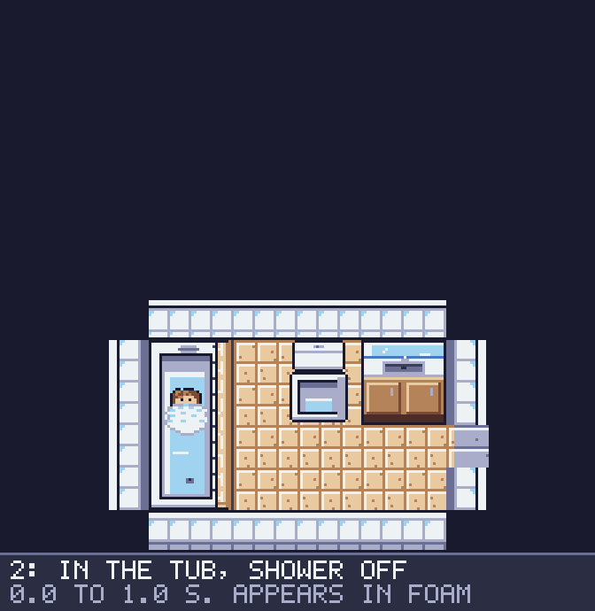
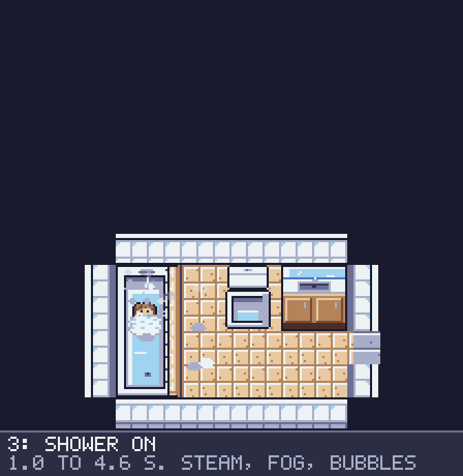

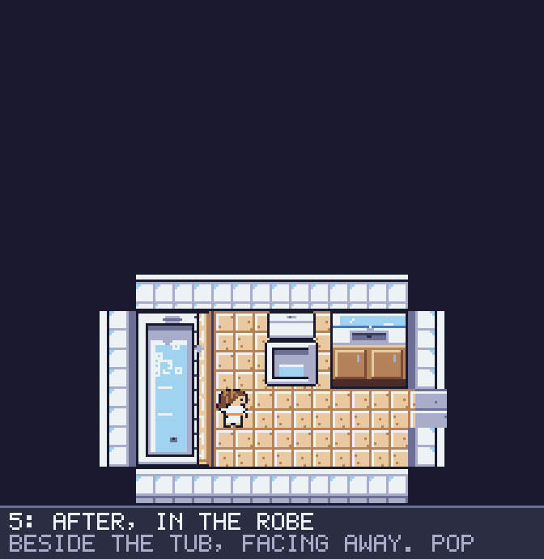

Picture 5 when no robe will be worn (the empty ROBE slot falls back to everyday clothes) and picture 3 under reduced motion:

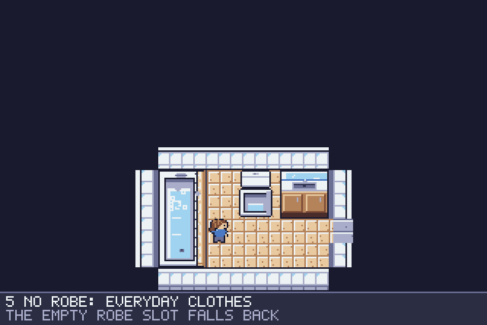
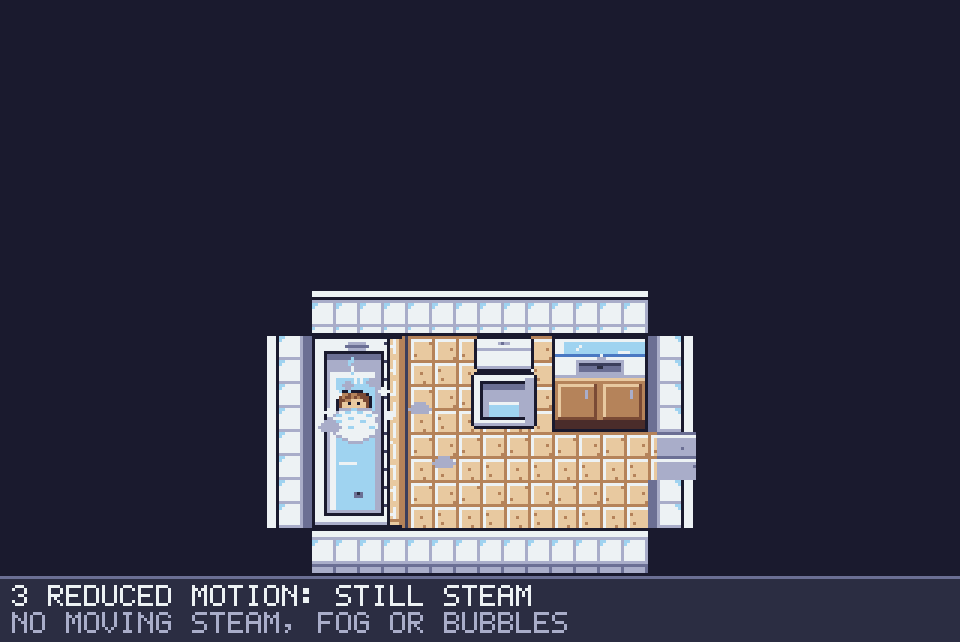

## 3. The pictures and the timing
The task keeps its 6 seconds, 70 points, mood +6, cooldown and good hours. Its pictures follow its progress through three **phases**, data in `config.ts` as fractions of the task's duration (so a changed duration keeps the shape):

| Phase | Fraction | Seconds (of 6) | Picture | Sound |
|---|---|---|---|---|
| `in` | 0 to 0.167 | 0.0 to 1.0 | the player appears in the tub in bubbles, the water off; one drip from the tap | none beyond the usual task-start blip |
| `water` | 0.167 to 0.767 | 1.0 to 4.6 | droplets fall from the tap end onto the bubbles; steam rises; fog drifts; a bubble floats off now and then | the hiss fades in over 0.25 s |
| `off` | 0.767 to 1 | 4.6 to 6.0 | the droplets stop, two or three late drips, the steam and fog thin out | a click, the hiss fades out in 0.12 s |
| after | the task has ended | (the room) | the player appears on the tile beside the tub, facing east (away from it), the bubbles pop (a burst of floating bubbles over the tub), wisps of steam fade over about 2 seconds | the usual chime with the popup |

The pose picture is one still picture for all three phases: the water is in the particles, not in the art. (The sleeping pose is the same idea: a picture, and effects over it.)

## 4. Art needed
One new sprite, palette only (22 colours), no text, ink outline where the style wants it, lit from the top left:

| Name | Size | Count | What |
|---|---|---|---|
| `player-shower-tub` | 16 x 48 | 1 | the player's head (hair and face, as `player-idle-down` rows 0 to 6) with a heap of bubbles from the chin down: opaque `paper` circles outlined in `mist`, a few `sky` glints. The head and bubbles fill the top 20 rows; the bottom 28 are clear |

Why 16 x 48 and not 16 x 20: the pose is drawn in front of the tub only if its bottom edge is not above the tub's (section 1: a stable sort by bottom edge). The tub piece is at y 16 and 64 tall (bottom 80); the pose goes at `at: { x: 6, y: 16 }` with height 48, so its bottom is also 80 and, being added after the pieces, it is drawn after the tub. Sprite sizes must be multiples of 16, so 48. The sofa's pose is shaped the same way.

Gender-neutral: a head over a heap of soap, the same width for everyone, starting at the chin; no shoulders, chest, hips or body outline is drawn. The pose is `clothed: false`, so it is also the same for every outfit and needs no per-outfit sprite (unlike every other pose: `poses.ts` `clothed`).

Not new art: the tub, the room, the robe and everyday sprites (the player after the task is the normal player), the steam, droplets, fog and bubbles (particles), the click and the hiss (sound). There is no curtain animation: the tub's own linen curtain strip stays as drawn.

A risk, not a blocker: the head in the pose is drawn by hand from the home sprite, so a later change of the hair means redrawing this one file. The plain player is not drawn under the pose, so nothing can leak through the bubbles.

## 5. Particles (reusing `src/game/particles`)
All data in `config.ts`; the game's one pool and feature draw them (section 1), so there is no separate pool. New shapes: `drop` (1 x 2), `cloud` (`.##.` / `####` / `.##.`), `fog` (8 x 4, `..####..` / `.######.` / `########` / `.######.`), `ring` (3 x 3). New kinds (colours are palette names; paper is invisible on the tub's rim, so steam leads with `mist`):

| Kind | Shape | Colours | What | Rate while the water runs |
|---|---|---|---|---|
| `showerDrop` | `drop` | `sky`, `paper` | falls from the tap end of the tub toward the bubbles: life 0.12 to 0.17 s, vy 48 to 62 px/s, a little gravity, so it ends above the head (the face stays clear) | 2 every 0.04 to 0.07 s, about 5 alive |
| `showerSteam` | `cloud` | `mist`, `mist`, `paper` | rises from over the tub and drifts a little: life 1.6 to 2.2 s, vy -9 to -5 (so it climbs 8 to 20 px over its life, up to the tub's north end and still inside the room), sway 1.6 px at 0.6 Hz, fades from 0.4 of its life | 1 every 0.14 to 0.24 s, about 10 alive |
| `showerFog` | `fog` | `mist`, `paper` | big, slow, long: life 3 to 4 s, vy -4 to -2, sway 3 px at 0.3 Hz | 1 every 0.5 to 0.9 s over the tub and the floor beside it, about 5 alive |
| `foamBubble` | `ring` | `sky`, `paper` | floats off the bubbles: life 1.2 to 1.8 s, vy -9 to -5, sway 1.2 px at 0.9 Hz | 1 every 0.5 to 0.9 s, about 2 alive |

The existing `steam` (2 x 2 `paper`, the coffee's) and `bubble` (the sink's `dot2`) were not reused as they are: too small and too pale for a tub. About 22 particles are alive at once against a budget of 200 shared with the steps and bursts; nothing grows (a full pool replaces the oldest). The phase filter and the `taskEmitters` entry `shower` turn them on and off: `in` has the lone drip, `water` the four emitters above, `off` the late drips and thinner steam and fog (the same kinds at lower rates).

**Phases from data.** `EmitterDef.phases` is typed for the sleep sequence and read from `game.sleepScene?.phase`. The change: `phases` becomes a list of strings, and a new data table `TASK_PHASES` (`config.ts`, by task id: `shower: [{ until: 0.167, phase: "in" }, { until: 0.767, phase: "water" }, { until: 1, phase: "off" }]`) feeds a `Game.taskPhase` getter (the running task's progress, `activity.progress`, mapped through its table; the sleep scene's phase when it has one), which the particle feature and the sound read. About 25 lines.

**After the task.** A new small data table (`PARTICLES.finish`, by task id) makes `ParticlesFeature` burst a few particles when that task completes (it already bursts confetti on `taskComplete`): about 8 `foamBubble` over the tub, so the bubbles "pop" as the player appears outside. The steam and fog already in the pool carry on and fade by themselves within about 4 seconds; leaving the room clears the pool. Escape leaves the same leftovers fading, with no burst (not a completion).

## 6. How it ends: where the player is, the robe, Escape
- **Where the player stands afterwards (d10, Marc's answer):** on the tile they stood on, **facing away from the tub**. The pose never moves the player (the bed's does not either): they pressed E on col 3, rows 1 to 4, facing left (west) at the tub, so that tile is free by construction and on the walkway, and nothing relocates the player or checks the map. The tub is on the west wall, so away from it is **right (east)**: after the task the player faces `right`, toward the room and the door (col 8, row 3). Both frames exist: `player-idle-right` and `player-pajamas-robe-idle-right` (every outfit has `idle-right`, `render/player-sprite.ts` `framesFor`), and the mockups for picture 5 use them. The flip is the one new bit of behaviour this answer adds: a data entry (`TURN_AWAY_AFTER: ["shower"]` in `config.ts`) and a few lines in `Game` on `taskComplete` that set `player.facing` to `right` (the tub is only ever faced from the east, so it is always `right`; `facing` is a plain field the host already writes, `activityHost().player.face`). Escape does not turn the player: they are still facing the tub, as they were.
- **The robe:** the occasion of issue 164 listens for `taskComplete` of `shower`, stores a pending change and applies it when no task, dialog or pose is active (164 section 5); `interaction.finish` sets `active` to null before `onComplete`, so the player is free the same frame unless an ad encounter starts (then it waits for the card). The change is `wearSlot("robe")`: the bathrobe if one is in the ROBE slot, otherwise the EVERYDAY outfit (an empty slot falls back to everyday: Marc's answer in 164). The pose draws no clothes, so there is no frame in which the wrong clothes show: the player is a head in bubbles, then the plain player in whatever was just put on. This scene must not write `worn` and does not touch the slots. It does not even need `outfitSlots.resolve`: the unbuilt part is entirely in 164. Until 164's occasion exists, nothing changes `worn` and the player simply reappears in what they wore.
- **Escape**, at any phase: the activity is cancelled (`cancellable` as today), which pays nothing, applies no mood, starts no cooldown and fires no `taskComplete`, so no occasion and no robe (164 relies on this); the pose goes and the plain player is back on their tile; the hiss fades in 0.12 s and `taskCancelled`'s blip plays; the shower can be started again at once. No skip-to-the-end (d6).
- **Touch:** nothing to press; "B TO STOP" is the existing hint.
- **Towel (Marc's aside under d5):** a towel as a ROBE-slot outfit, even the default, would be new outfit art through the generator (issue 158: 17 sprites per outfit) and a decision about styles under 164's strict slots. It is not part of this scene; Marc's answer (d9) is not now, and a towel is a later outfit idea.

## 7. Sound (d3)
A soft hiss while the water runs, a quiet click when it stops, the music and a playing record left alone (no ducking, unlike sleep).

| Cue | When | Sound |
|---|---|---|
| hiss | the `water` phase | steady filtered noise: a high-passed layer (about 2,400 Hz, gain 0.05) and a band-passed body (about 900 Hz, q 0.5, gain 0.04), faded in over 0.25 s |
| `showerClick` | the end of `water` | two voices, about 30 ms: a square at 150 Hz and a band-passed noise tick at 1,400 Hz; the hiss fades out in 0.12 s |

The level is about the snore's noise layer (0.04) and well under the steps; the existing task-start blip and the completion chime still play. Mute is the master gain, which none of this touches.

**What the engine needs:** a noise voice lasts one 0.5 s buffer with a falling envelope and an effect cannot be cut off once scheduled (section 1), so a 3.6 s hiss that Escape can end needs: a new bus `shower` (like `sleep` and `encounter`: the `Bus` type, the `ramps` entry, made lazily, silent until ramped); `NoiseVoice` gets optional `loop` and `hold` (the existing formant `hold` generalised, `synth.ts:159`); `BufferSourceLike` gets `loop`; and a class `ShowerSound` (`sound/shower-sound.ts`, modelled on `SleepSound`) reads `game.taskPhase` each frame, ramps the bus up for `water` and down otherwise, and puts it back to zero when the task is gone for any reason (a cancel, an error, a tab switch). With no synth it does nothing. About 25 lines in the synth and types, 70 in `ShowerSound`, 120 of tests with the fake audio context. The fallback with no engine change is repeating a short noise burst every 25 ms with overlapping tails (about 40 overlapping voices a second against a cap of 96; it flutters).

## 8. Reduced motion (d4)
Marc's answer: the steam is still and the bubbles do not move; the scene is otherwise the same. With the browser setting on (`Game.reducedMotionAsked`, read each frame so a mid-task change takes effect, like the candle):

| Thing | Normal | Reduced |
|---|---|---|
| Steam | clouds rise and sway | a fixed set of 6 clouds placed over the tub and beside it when the `water` phase starts, living the 3.6 s of the phase and then gone, no motion, no fade |
| Fog | drifting clouds | a fixed set of 3, the same way |
| Floating bubbles | rise and sway | not made (the pose's bubbles are a still picture anyway) |
| Pop at the end | a burst of rings | not made |
| Droplets | fall from the tap end | unchanged: 1 x 2 pixels, a few pixels of travel in 0.15 s; they are the signal that the water is on (d11: Marc kept them) |
| Phases, timing, sound, Escape, the pose, the robe | as designed | unchanged |

How: an emitter gets a flag, `motion: "moves"` (skipped when reduced; the default) or `"still"` (runs only when reduced); a still emitter has `every` at least as long as the phase, so it makes one batch per phase (an emitter that stops applying forgets its timer and "starts with a puff next time", section 1), and its kind has a life as long as the phase and zero speed. The mockup (3 with reduced motion) shows it. About 10 lines in the feature, plus data. `docs/reduced-motion.md` gets a row after building. There is no screen cut and no brightness change in this scene at all (it is the room, already on screen), so nothing here is a flash.

## 9. Edge cases and what could go wrong
1. **Carrying a coffee** (state `mug` 1): the plain player, who holds the mug overlay, is not drawn during the pose; the mug steam is an ambient emitter that needs `free: true`, false while a task runs, so it stops; both come back after, since the state is untouched. Dishes, the plant, the boxes and every other state are untouched; the shower changes only mood (+6).
2. **The clock:** the shower does not hold or skip it, so 6 s of play is 12 game minutes, as today; the time-of-day tint and the lamps carry on. A shower that straddles a good-hour boundary is judged at completion, as now.
3. **A record playing:** the music goes on; the record player's note emitter is anchored to `record-stand`, which is not in the bath, so it makes none there (anchors return null for a missing piece).
4. **Loading a save, or "sync now", mid-shower:** tasks are not saved, so a loaded game starts with the player free on their tile and nothing in the pool; applying another device's decor mid-task does not touch the pose.
5. **An ad encounter right after (and the turn):** the turn happens on `taskComplete` with the rest, before the card; the encounter starts after `taskComplete`; the player stands in the old clothes behind the card until it ends and the occasion applies (164's gate).
6. **Missing pose art:** the plain player is drawn and the missing file is logged once (`currentPose`), so a half-built stage never breaks the task; the particles still run.
7. **The pose hidden behind the tub:** only if its bottom edge falls above the tub's, so the build fixes `at.y + size.h` to the tub's bottom (80) and a test checks it, like the existing "draws the pose after the furniture it overlaps" (`poses.test.ts`).
8. **A dialog or popup during the task:** popups rise above the pose picture (`playerPopup`); a dialog cannot open during a task.
9. **Particles outside the room:** the view is mostly ink above the bath, and steam would show over it if it rose past the north wall; the speeds above keep it within about 20 pixels of where it starts, inside the room (looked at in the mockup, not at speed).
10. **Spam:** a 10 s cooldown plus the 6 s scene means a shower every 16 s plays the whole scene again (d7: Marc said yes).
11. **The scene is small on screen.** At 1x the bubbles are 16 pixels wide in a 320 x 192 picture. That is the game's normal scale and what Marc chose (no close-up); the detail mockups are 6 times life size.
12. **The golden frames:** the bath is not in `main-room-frames.golden.test.ts` (the main room only) and the pose draws only during the task, so nothing there changes.

## 10. What 164 must provide and what 165 must not do
Per the 164 design and Marc's answers: the scene keeps the task id `shower` (the occasion is keyed on it, `OUTFIT_OCCASIONS = { sleep: "pajamas", shower: "robe" }`); never writes `worn`; never assumes the robe is owned; the change is deferred until no task, dialog or pose is active, so it cannot be used inside the scene and need not be, since the pose draws no clothes. Return to everyday is by hand only (Marc's answer), so after the shower the player stays in the robe until they change clothes or the next occasion (sleep).

## 11. Build plan (nothing is built)
Three stages, each a branch and an independent review. 1 and 2 are independent; 3 follows 2.

| Stage | What | Size |
|---|---|---|
| 1. The pose | `player-shower-tub` (16 x 48) in `art/src`; `POSES["shower-tub"]` (`clothed: false`, `on: "tub"`, `at: { x: 6, y: 16 }`, size 16 x 48); `shower: { pose: "shower-tub" }` in the task table (the effects stay). Tests: the pose is in front of the tub, falls back to the plain player when the art is missing, the plain player is back after the task and after Escape, points and mood unchanged. | 1 sprite, about 8 lines of config, about 70 lines of tests |
| 2. The effects | `TURN_AWAY_AFTER` and the turn on completion (about 8 lines); `TASK_PHASES` and `Game.taskPhase`; string phases in `EmitterDef`; `motion` on emitters; `PARTICLES.finish`; the four shapes and four kinds, `taskEmitters.shower`, the still variants; the finish burst in the feature. Tests: the player faces right after a finished shower and still faces the tub after Escape; every shape and kind exists, phases switch at the fractions, emitters run only in their phase, reduced motion runs only still emitters and one batch per phase, the finish burst on completion and not on Escape, the pool never exceeds its budget over a whole shower. A render check of the five pictures with the real art. | about 60 lines of config, 40 of code, 150 of tests |
| 3. The sound | The `shower` bus, noise `loop` and `hold`, `showerClick`, `ShowerSound` wired in `SoundFeature`. Tests with the fake audio: bus up in `water`, zero after Escape and after the end, nothing without a synth, mute untouched. | about 25 lines in the synth, 70 in `ShowerSound`, 120 of tests |
| Integration | Once 164's stage 2 exists, a test: finishing `shower` puts the player in the ROBE slot's outfit, or everyday with none, and Escape changes nothing. No code of 165's. | about 40 lines of tests |

Docs to update when built: [reduced-motion.md](reduced-motion.md) (a row), [art-style.md](art-style.md) (the one sprite), [tasks.md](tasks.md) (the shower), [ideas.md](ideas.md) (remove 'Put on the robe after a shower').

## 12. Questions
All answered by Marc on 2026-11-24 (d1 to d8, then d9 to d11); nothing is open. d9: no towel now; an empty ROBE slot falls back to everyday clothes, and a towel is filed as a later outfit idea (new art through the outfit generator and a style decision under 164's strict slots). d10: the player appears on the tile they stood on, facing away from the tub (section 6). d11: the droplets stay under reduced motion (the planner's call: they are what says the water is on), so section 8 stands as written.

## 13. Not checked
- Nothing was run in a browser: how the scene looks and feels at real size and speed, the timing, the touch layer and how small the bubbles read on a phone are designed from the code and the mockups.
- The mockup pose art is drawn in code as a stand-in; the particles are placed by a small simulation that re-implements the pool's equations (position, velocity, gravity, sway and the three-step fade) outside the game, not by the real pool. The HUD, popup and confetti are not drawn. The camera's placement of the room is taken from `camera.ts`, not seen in the running game.
- The hiss and the click were not heard; the synth additions were read, not tried.
- Issue 164 is a design on an unmerged branch: the slots, the occasion and "return to everyday is by hand" are taken from its note and from Marc's answers on its issue, not from code.
- Whether steam and fog stay inside the room's walls at real speed, and whether the 16 x 48 pose sorts in front of the tub exactly as the sofa pose does, were read from the draw code, not seen.
