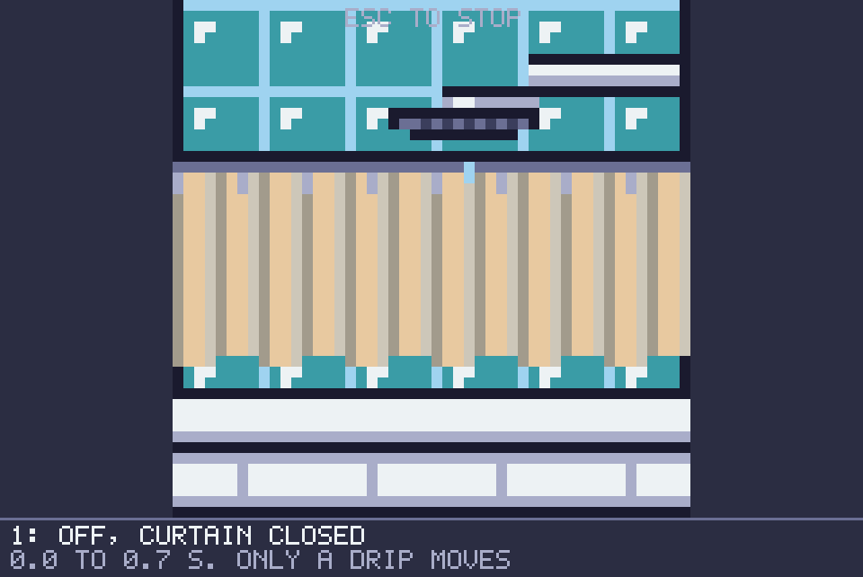
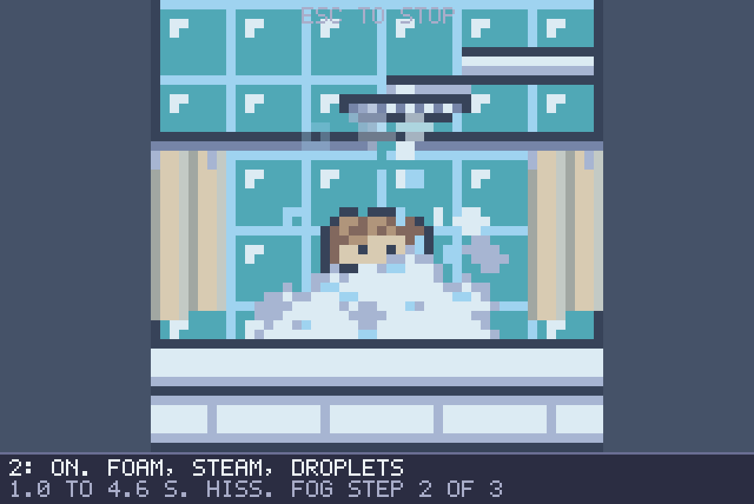
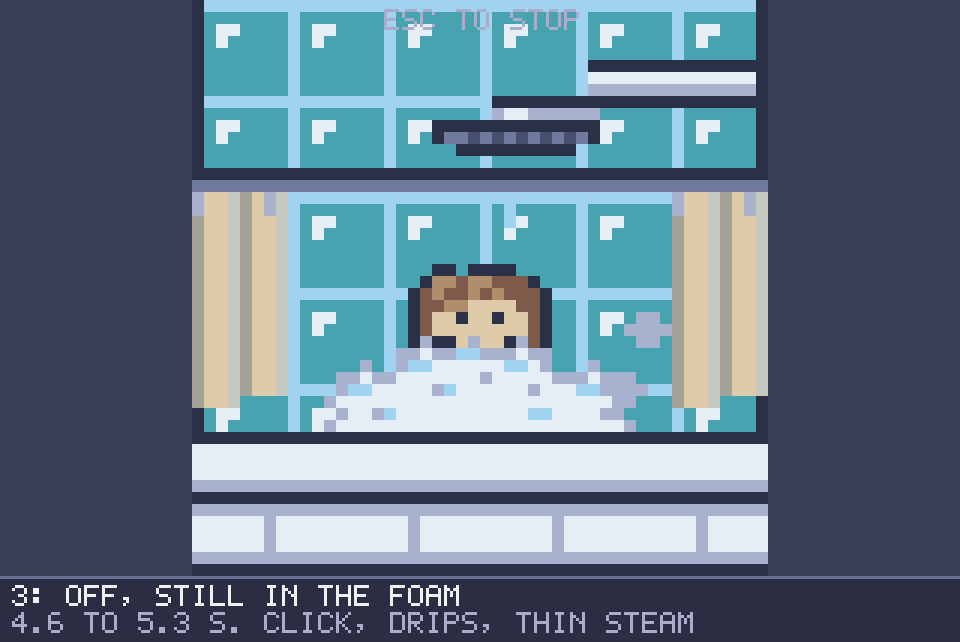
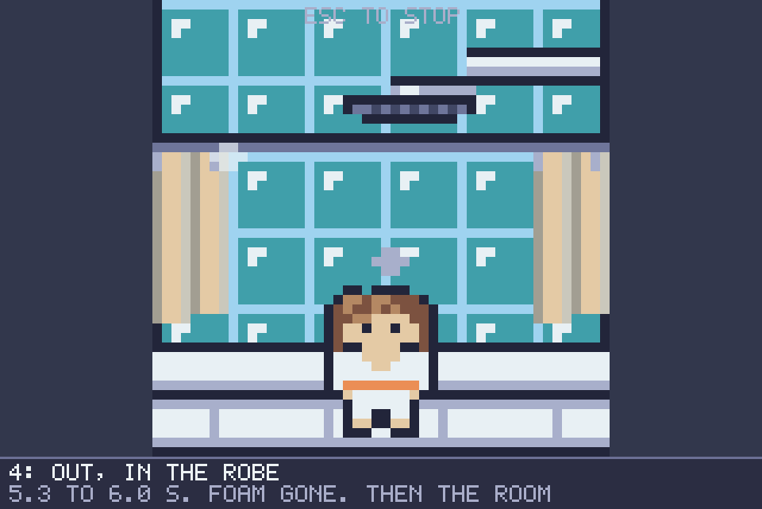
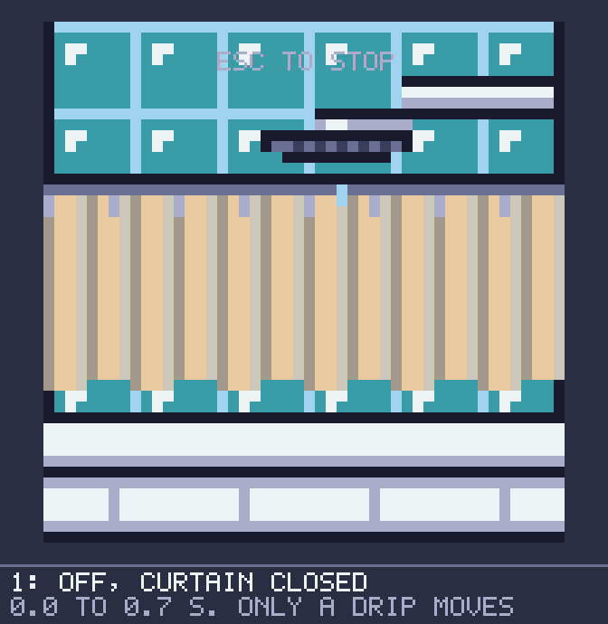
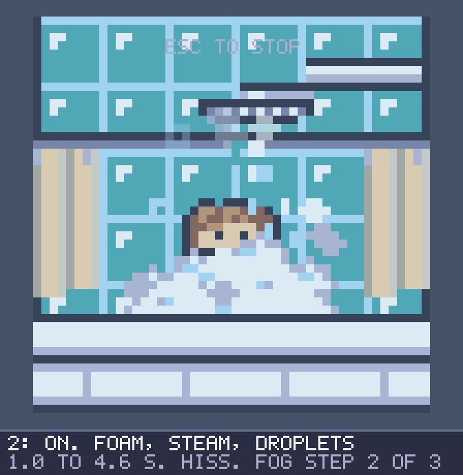
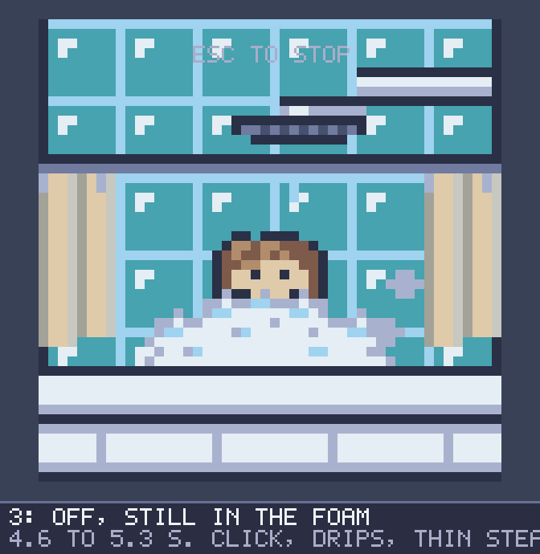
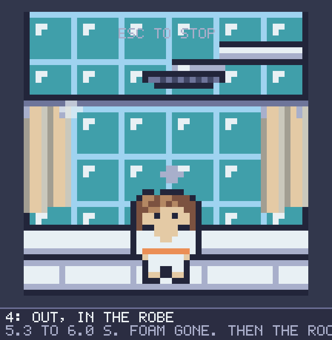
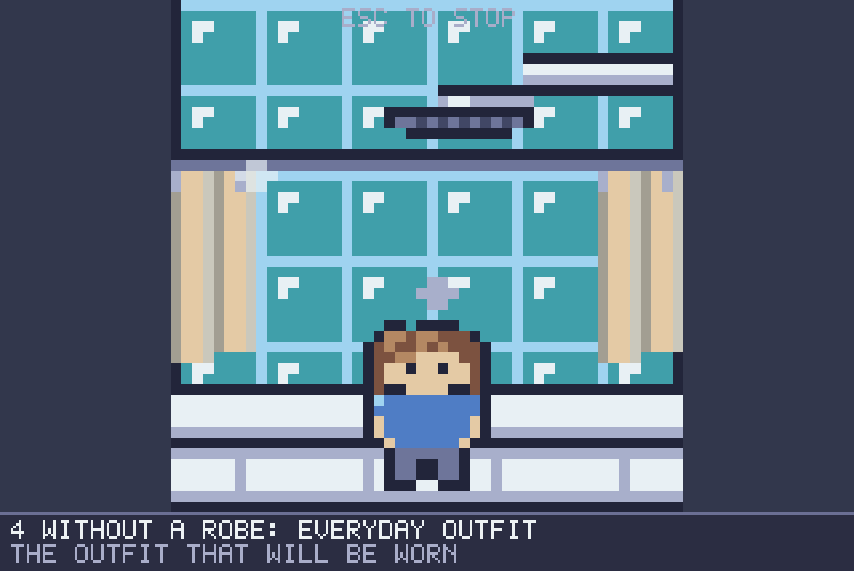
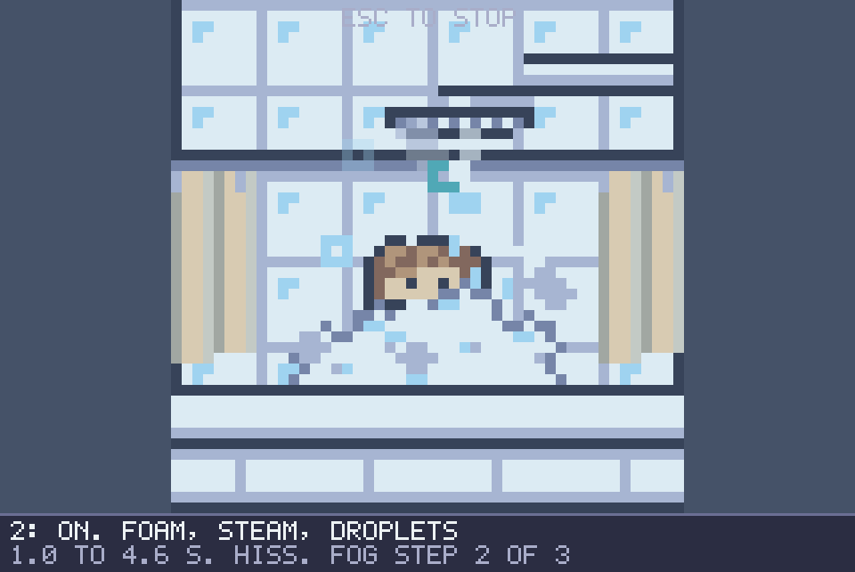

# A Sims-like shower scene that ends in the bathrobe (design note, issue 165)

Status: a design for Marc to confirm. Nothing is built; `src/` and `art/` are untouched. The four open questions from the filing (d1 to d4) are in [issues/165-shower-scene.md](../issues/165-shower-scene.md) and are still open: this note designs for the recommended answer of each and says what changes if Marc picks another. Four more questions found while reading the code (d5 to d8) are in the same file. Idea notes: [ideas.md](ideas.md) 'Put on the robe after a shower' (with Marc's 2026-11-24 addition). It builds on the outfit slots design of issue 164 ([outfit-slots-design.md](outfit-slots-design.md) on the branch `issue/164-outfit-slots`, not merged yet), and on the composed-view precedents: the sofa scene (issue 117, [photo-gallery-design.md](photo-gallery-design.md) 3.5), the side project's composed room (issue 111, [side-project-config-design.md](side-project-config-design.md)) and the sleep sequence ([sleep.md](sleep.md)).

## In short
- **One scene, drawn by a new activity.** Taking a shower becomes a full-screen close-up of a shower stall, for the whole 6 seconds the task already lasts. The task keeps its id `shower`, its 6 seconds, its 70 points and its mood +6 (`tasks.ts:90,189`). The activity draws everything itself, in screen space, like the sofa scene (`activities/reel.ts`).
- **Four pictures, in order:** (1) shower off, the curtain closed (you step in); (2) the curtain open, the shower on, you in a heap of soap bubbles with only your head showing, droplets falling, steam rising, the window of the stall fogging; (3) the shower off with a click, still in the bubbles, steam thinning; (4) out, in the bathrobe, the bubbles gone. Then the scene ends and the room is back, with the usual popup and confetti.
- **The bubbles do the covering.** Nothing below the chin is ever drawn except bubbles (and, in the last picture, the robe). So there is no body art, no clothes-free sprite, and the picture is the same for everyone.
- **Particles reuse the particle pool** (`src/game/particles`) but with the scene's own pool, because the game's pool is drawn in the world pass, which the full-screen scene covers (section 1). Three new particle kinds and three tiny shapes, all data in `config.ts`.
- **Sound:** a soft hiss while the water runs, a quiet click each time the tap turns. The hiss needs a small engine addition (section 6), because today a noise voice cannot last longer than half a second or be cut off.
- **Escape** backs out at any moment: no points, no mood, no robe, no cooldown, as for every task.
- **Reduced motion:** the steam and bubbles hold still, the curtain cuts instead of sliding, the fog does not fade; the four pictures and the timing stay.
- **The robe is not this scene's to put on.** The last picture draws whatever outfit the occasion will put on (the bathrobe if one is in the ROBE slot, otherwise the outfit already worn), and the real change follows from issue 164's occasion when the task ends.
- **Size:** about 7 sprites, 3 particle kinds, 2 sound effects, one activity, one tiny sound class and about 25 lines in the synth. Four stages, each its own branch and review (section 11).

Mockups (section 3) were rendered with the game's own palette, the real player and robe sprites and the 5x7 font; the scene's new art in them is drawn in code as a stand-in. They are three or four times life size.

## 1. What the code does today (checked)
Line numbers are for `main` at `b1db29a`.

| Claim | Where |
|---|---|
| `shower` is a plain timed task: 6 seconds, 70 points, no pose, no activity (so a `WaitActivity`); effect mood +6; good hours 06:00 to 10:00 and 20:00 to 23:00; cooldown is the default 10 s. | `tasks.ts:90,189,349`; `config.ts:69` `DEFAULT_TASK_COOLDOWN`; `docs/tasks.md:129` |
| It is offered at the tub (map letter `U`, a 2 x 4 piece down the west wall of the 9 x 6 bath). The toilet `Q` and the vanity sink `V` are against the north wall; the door is on the east wall. | `apartment.ts:231-244`; `docs/floor-plan.md` 'Bath' |
| An activity is a class registered by name; a task asks for it with `activity: { type: "..." }`. Registered kinds are imported in `activities/index.ts`. `WaitActivity` is the plain timed one: it counts `elapsed`, sets `progress` and finishes `{ completed: true }`. | `activity.ts:220` (`registerActivity`), `activities/wait.ts`, `activities/index.ts` |
| An activity's `draw(ctx, screen, avoid)` is called after the world, the world UI and the HUD, so it covers all of them, and the "ESC TO STOP" hint is drawn after it, on top. `screen` is the live view: `DESKTOP_VIEW` 320 x 192 or `NARROW_VIEW` 224 x 208 on a phone. | `game.ts:857-863,868-876`; `config.ts:6-12`; `activity.ts:156` |
| Escape cancels a cancellable activity (`activity.cancel()`); `finish` with `completed: false` returns before the effects, the score, the cooldown and `onComplete`, so `taskComplete` is never emitted; `taskCancelled` is. Completion applies the effects, scores, then `onComplete` (the popup, the `taskComplete` event). | `interaction.ts:159-160,302-347` |
| Particles live in a `ParticlePool` (a fixed set of slots, reused; `spawn`, `update(dt)`, `draw(ctx)`). `draw` fills 1-pixel squares at `Math.round(x), Math.round(y)` in **whatever coordinates the context has**, so a scaled context draws them chunky. A kind is data (`PARTICLES.kinds`), a shape is a small `#` grid (`PARTICLE_SHAPES`); an unknown shape or kind throws. | `particles/pool.ts:82-176`; `config.ts:1415,1468-1498`; `particles/effects.ts` (`kindOf`, `puff`) |
| The game's one pool is drawn by `ParticlesFeature.drawWorld`, in the world pass; `taskEmitters` (by task id) anchor to the task's zone, pose, a piece or the player, all in world pixels. The world pass is under the scene (`game.ts:859` comes after it), so an emitter for `shower` would draw particles nobody sees. | `particles/feature.ts:134,150-200`; `config.ts:1546`; `game.ts:857-859` |
| Reduced motion is read in one place, `reducedMotionAsked` / `liveReducedMotion` (`reduced-motion.ts`), passed into `Game` (`main.ts:25`) and exposed as `Game.reducedMotionAsked` (`game.ts:155`); the candle reads it every frame and the ad encounter once at its start. The `ActivityHost` an activity receives has **no** reduced-motion member today; the encounter gets it through its own dependencies (`game.ts:306`). | `reduced-motion.ts`; `game.ts:155,306,339-377`; `time-of-day/feature.ts:151` |
| Sounds: an effect is `{ voices: [...] }` in `SOUND.effects` (`config.ts:1127`); a **noise voice** is a filtered noise with `freq`, `q`, `length`, `gain`. The noise buffer is **0.5 s** long and played once (`NOISE_SECONDS`), every voice's gain starts at its peak and ramps **exponentially down** to silence over its length, and only formant voices have `hold`. An effect cannot be stopped once scheduled. Buses: `effects`, `music`, and the lazily made `sleep` and `encounter`, which can be ramped (`rampBus`). | `sound/synth.ts:15-18,102,152-165,224-232`; `config.ts:659-667`; `sound/audio-types.ts:48-53` |
| The sleep scene is the model for a sound that follows a scene: `SleepSound` reads the scene each frame, ramps its own bus, and puts everything back by itself when the scene is gone for any reason; with no audio context it does nothing. Mute is the master gain, which no bus touches. | `sound/sleep-sound.ts:7-16` |
| Composed full-screen scenes lay themselves out for both views from the live `screen` size: the sofa scene does it for 320 x 192 and 224 x 208 without switching the view (`showsPicture`, which flips a phone to 320 x 192, is only for pictures drawn for the desktop size). | `docs/photo-gallery-design.md` 3.5; `game.ts:635-642` |
| The game's canvases have image smoothing off (`render/canvas.ts:259,271,329,344`), so a sprite drawn under `ctx.scale(4, 4)` stays crisp; `Sprites.draw` rounds the position and draws at the image's own size. `SpriteDrawer.drawScaled(ctx, name, x, y, scale, smooth)` also exists (smoothing off when `smooth` is false) but **nothing calls it today**, so the scene uses `ctx.save(); ctx.translate(stage); ctx.scale(4, 4); sprites.draw(...)`, the same transform it gives the particle pool. | `render/canvas.ts`; `render/sprites.ts:104-140` |
| Sprite sizes must be multiples of 16 (except `icon-*`); every sprite the game asks for is listed in `render/sprite-names.ts` and `sprite-names.test.ts` fails if a file is missing. The palette has 22 colours (`art/palette.json`). | `scripts/sprite-lib.mjs:30-48`; `render/sprite-names.ts`; `docs/art-style.md` 'Grid' |
| The player is 16 x 16. The head is rows 0 to 6 of every standing sprite (hair and face); the torso starts at row 7 and differs by outfit. The robe is `player-pajamas-robe-*`, generated, with bare ankles. | `art/src/player-idle-down.sprite`, `art/src/player-pajamas-robe-idle-down.sprite`; `outfits.ts:24-41` |
| The bed pose is `clothed: false`, a whole picture with no clothes showing (issue 150); there is no outfit-free standing sprite and none is needed here (section 4). | `poses.ts:66-80` |
| There is no outfit slot code on `main`: `outfitSlots`, `resolve` and `OUTFIT_OCCASIONS` exist only in the design on the 164 branch. | `grep` over `src/` finds none |

## 2. Where it plays (d1) and what it is made of
d1 recommends a composed close-up. So the scene is a new activity, `shower` (`activities/shower.ts`), registered like `sleep` and `reel`, and the task becomes `activity: { type: "shower" }` (duration still the task's 6 s; the activity reads `item.duration` and works in fractions of it, so changing the duration later keeps the shape). It sets `cancellable = true`. It does **not** hold the clock (`holdsClock` stays false): today a shower takes 6 real seconds of game clock (12 game minutes) and that is unchanged. It does not set `showsPicture`: the scene is laid out for the live view itself.

**The picture.** A front-on view of the stall, drawn at **4 times** the art pixels. The stage is 48 x 48 art pixels (3 tiles square), so 192 x 192 on screen: a square in the middle of the view, with `night` around it. Why 4x: the player is 16 x 16 and a head at 4x is 64 px wide, large enough to read the face and the bubbles, small enough that the whole stall fits on both screens. (3x made the figure a speck; 2x is the world's own scale and makes it worse.)

| View | Screen | Stage position | Around the stage |
|---|---|---|---|
| Desktop | 320 x 192 | x 64 to 256, y 0 to 192 | `night`, 64 px each side |
| Phone | 224 x 208 | x 16 to 208, y 8 to 200 | `night`, 16 px each side, 8 above and below |

Both are `Math.floor((screen - 192) / 2)`, so the stage is on a whole pixel. The view does not switch: `NARROW_VIEW` and `DESKTOP_VIEW` already give `draw` their own size. The "ESC TO STOP" hint (`B TO STOP` on touch) is drawn by the game on top of the scene at the top centre (desktop) or under the chips (phone, `stopHintAt`); the shower arm sits below it (art row 5 and down) so they never meet.

**What the stage shows (all front-on; the tub is the one furniture piece the art style draws from above, `art-style.md` exceptions, so the stall is its own picture, like the bed pose):**
- a tiled wall with a shower arm and head on the right (the head hangs over the middle);
- a linen curtain on a rod, drawn in three states (closed, half open, open), in the colours of the tub's own curtain (`tub.sprite`: cream, putty, taupe);
- the front of the tub as a rim and a face across the bottom, with the figure behind or, in the last picture, in front of it;
- the figure: the player's **head** (rows 0 to 6 of the real `player-idle-down` sprite, drawn at 4x) with a heap of foam covering everything from row 7 down. So the figure is the same for every outfit and never shows a torso, an arm or a leg: the scene needs **no clothes-free art**.

**Tile colour (d8).** The real bath is white glossy tile with grout every 8 px (`art-style.md`, issue 054). In the mockups the stall's tile is **teal** for one reason: a white heap of bubbles on white tile cannot be read (see `shower-desktop-2-white.png`, same frame on white tile; the foam's outline has to be dusk and still looks like a smudge). Teal is therefore a departure from the apartment, flagged as d8 with the recommendation to keep it.

## 3. The four pictures (mockups)
Timeline for the 6 second task (fractions of `item.duration` in the data; seconds are for 6):

```
0.0                0.7   0.85  1.0                             4.6   5.3     6.0
|-- 1 off, curtain closed --|     |--------- 2 on --------------|-- 3 off --|-- 4 robe --|
        drip       curtain half, open     hiss, foam, steam, droplets, fog    click, drips,    foam gone,
                                          bob 0.5 s                          steam thins     fog 6 percent
```

| Picture | Seconds | What is drawn | Sound |
|---|---|---|---|
| 1 Shower off, curtain closed | 0.0 to 0.7 | the closed curtain over the stall, the head dripping once or twice | none (the usual start blip) |
| (curtain) | 0.7 to 1.0 | half open for 0.15 s, then open | none |
| 2 On | 1.0 to 4.6 | nozzles lit; droplets from the head to the figure; steam rising from the tub and drifting up; a small bubble now and then from the heap; the foam alternates between its two shapes every 0.5 s; fog steps up to its second level; | the click, then the hiss (fades in 0.25 s) |
| 3 Off | 4.6 to 5.3 | nozzles dark; two or three late drips; steam thinning; the foam still, one shape; fog drops one level | the click, the hiss fades out in 0.12 s |
| 4 Out, in the robe | 5.3 to 6.0 | the foam gone; the figure in front of the tub in the outfit that will be worn (the real `player-pajamas-robe-idle-down` sprite, 4x); a wisp of steam; fog at its last level | none (the usual chime comes at the end with the popup) |

Desktop (320 x 192, shown 3x with a caption strip that is not part of the game):






Phone (224 x 208), the same four:






Picture 4 when no robe will be worn (d5, recommended: the scene shows the outfit that will be worn, here the everyday one), and picture 2 on white tile for comparison (d8):




What the mockups are and are not: the stall, curtain and foam are drawn in code as stand-ins (real art is stage 1); the head and robe are the real sprites; the particles are placed by a small simulation that uses the pool's own equations (position, velocity, gravity, sway, the three-step fade) re-implemented outside the game, not by the real pool; the stop hint on the phone is drawn at an estimated height. Nothing was run in a browser.

## 4. The art needed
All palette only (the 22 colours), no text, multiples of 16, ink outlines where the art style wants them, lit from the top left. Seven new sprites, about 14,000 pixels:

| Name | Size | Count | What |
|---|---|---|---|
| `shower-stall-off` | 48 x 48 | 1 | the tiled wall, the arm and head (nozzles dark), the tub's front rim and face; the lower rows of the wall behind the figure are plain tile |
| `shower-stall-on` | 48 x 48 | 1 | the same with the nozzles lit (`paper`) |
| `shower-curtain-0`, `-1`, `-2` | 48 x 48 | 3 | closed, half open, open; rod and rings, pleats, a scalloped hem; transparent where there is no curtain |
| `shower-foam-0`, `-1` | 32 x 16 | 2 | the heap of bubbles: an **opaque** cluster of circles in `paper`, an outline of `mist`, a few `sky` glints; the second shape differs by a few pixels (the bob). It must be opaque so no outfit shows through |

Not new art: the head (rows 0 to 6 of `player-idle-down`), the robe frame (`player-pajamas-robe-idle-down`) or the worn outfit's `idle-down`, the steam, droplets and bubbles (particles), the fog (a stepped alpha wash).

**The covering rule, and a test for it.** The foam must hide every opaque pixel of `player-idle-down` from row 7 down. The mockup script checked it: 0 uncovered pixels with the foam drawn here. The build adds a test that does the same on the real sprites (so a future change of the hair or the sprite cannot leak a torso).

**Gender-neutral.** The picture shows a head over a heap of soap. No chest, hips or body outline is drawn; the heap is the same width for everyone and starts at the chin. The bare shoulders are not shown at all (the heap reaches the chin), which is also what keeps this clear of the censor-blur joke going too far: it is the same joke, made with soap.

**Particles (data in `config.ts`, three new kinds and three shapes):**

| Kind | Shape | Colours | What | Rate (while on) |
|---|---|---|---|---|
| `showerDrop` | `drop` (1 x 2) | `paper`, `sky` | falls from the head to the figure: life 0.16 to 0.22 s, vy 60 to 80 px/s, gravity 100, x spread 8 | 2 every 0.03 to 0.06 s, about 12 alive |
| `showerSteam` | `cloud` (4 x 3: `.##.` / `####` / `.##.`) | `paper`, `mist` | rises from the tub's rim and sways: life 1.8 to 2.6 s, vy -13 to -7, sway 2 px at 0.6 Hz, fade from 0.4 | 1 every 0.18 to 0.3 s, about 10 alive (every 0.5 to 0.8 s in picture 3, every 0.7 to 1.1 s in picture 4) |
| `foamBubble` | `ring` (3 x 3) | `paper`, `sky` | a bubble floating off the heap: life 1.4 to 2.2 s, vy -11 to -6, sway 1.5 px at 0.9 Hz | 1 every 0.4 to 0.8 s, about 3 alive |

The existing `steam` and `bubble` kinds were not reused as they are: `steam` is 2 x 2 `paper` (invisible on a pale wall), `bubble` is the sink's tiny `dot2`. All three live in a second pool of about 60 slots owned by the activity (`new ParticlePool(60, random)`), updated with the activity's `update(dt)` and drawn in `draw` with `ctx.scale(4, 4)` after translating to the stage, so a particle's pixel is 4 screen pixels and nothing else changes in the pool. At most about 25 are alive, well inside the budget; nothing grows. The fog is a stepped alpha wash in `sky` over the whole picture (0, then 0.12, then 0.22 while on; 0.12 in picture 3; 0.06 in picture 4; moves in steps over 0.7 s), the same device as the night wash: it is slow and never flashes.

## 5. How it ends, what the robe has to do with it, and the numbers
- **Points and mood are unchanged** (70 points, mood +6, 6 seconds, 10 second cooldown, good hours). The scene is only a picture of the task (Marc has said nothing to change them; the filing says "unchanged unless Marc says"). d7 asks whether a shower you take every 16 seconds should play the whole scene each time.
- **When it ends**: after picture 4 the activity finishes `{ completed: true }`; the game applies the effects, scores, shows the popup and confetti (over the tub, in the room that is now visible again) and emits `taskComplete` for `shower` (`interaction.ts:302-347`).
- **The robe is not put on by the scene.** Issue 164's occasion listens for `taskComplete` of `shower`, stores a pending change and applies it when no task, dialog or pose is active (164 section 5), so the real change of `worn` follows the end of the scene. The scene must not write `worn` and does not touch the outfit slots. It only needs to **draw the outfit that is about to be worn** in picture 4, so there is no pop at the cut back to the room.
  - The outfit it draws is `outfitSlots.resolve("robe")` (the name used in the 164 design, which says it returns the outfit that the ROBE occasion will put on: the bathrobe if one is in the slot, otherwise the EVERYDAY outfit). The scene must not assume the robe is owned: a game with no robe shows picture 4 in the everyday outfit (mockup 4b).
  - Until 164's stage 2 exists nothing changes `worn` after a shower, so the scene must draw **the outfit worn now**, not the robe, or the scene would put you in the robe and the room would take it away. So build stage 4 (section 11) is blocked on 164 and is one function: `outfitForShowerEnd()`; before it exists, it returns the worn outfit.
- **If the player skips it (Escape)** at any point: the activity is cancelled, which pays nothing, applies no mood, starts no cooldown and fires no `taskComplete`, so **no robe and no occasion** (164 relies on exactly this). The hiss fades in 0.12 s (section 6), `taskCancelled`'s existing blip plays, the world is back with the player unchanged, and the shower can be started again at once. d6 asks whether a separate way to skip to the end and be paid is wanted; the recommendation is no (the universal back-out stays one thing, as in the sofa scene's Escape).
- **Interruptions.** An ad encounter can only start after `taskComplete` (`maybeEncounter`), never during the scene; a dialog cannot open during it. The 164 gate defers the outfit change until the card is over.

## 6. Sound (d3)
Recommended: a soft hiss while the water runs and a quiet click when the tap turns; the music and a playing record are left alone (no ducking, unlike the sleep scene).

| Cue | When | Sound |
|---|---|---|
| `showerClick` (on) | the shower comes on (1.0 s) | two voices, about 30 ms: a square at 150 Hz and a band-passed noise tick at 1,400 Hz; played at pitch 0.85 |
| hiss | from the click until the off click | filtered noise, steady: a high-passed layer (about 2,400 Hz, gain 0.05) and a band-passed body (about 900 Hz, q 0.5, gain 0.04); fades in over 0.25 s |
| `showerClick` (off) | 4.6 s | the same click at pitch 1.0; the hiss fades out in 0.12 s |

The level is about the snore's (the quietest sound in the game, 0.04) and well under the steps; the scene adds nothing on top of the existing task start and complete sounds, which still play (a short blip at the start and the chime with the popup at the end).

**What the engine needs (small, and the one place this design touches the sound code):**
1. A noise voice can run only 0.5 s once with a falling envelope (`synth.ts:17,152-165,224-232`), and an effect cannot be cut off once scheduled, so Escape in the middle of a 3.6 s scheduled hiss could not stop it. The recommended fix: a new bus `shower` (like `sleep` and `encounter`: `Bus`, the `ramps` entry, lazily made, silent until ramped); `NoiseVoice` gets optional `loop` and `hold` (the existing `hold` for formants generalised: `synth.ts:159`); `BufferSourceLike` gets `loop`; a class `ShowerSound` in `sound/shower-sound.ts`, modelled on `SleepSound`, reads the activity's scene each frame (a small `{ on: boolean }` the activity exposes, like `scene`), ramps the `shower` bus up and down, and puts it back to zero when the scene is gone for any reason (so a cancel, an error or a tab switch cannot leave a hiss). With no synth it does nothing: the scene runs in silence. About 25 lines in `synth.ts` and `audio-types.ts`, 70 in `ShowerSound`, 120 of tests with the fake audio context.
2. The cheaper fallback, with no engine change: repeat a short noise burst about every 25 ms with overlapping tails. It is about 40 overlapping voices a second against a cap of 96 and flutters; use it only if Marc does not want the engine addition.

Mute works with either: mute is the master gain, which neither touches. Sounds are not motion, so reduced motion leaves them alone.

## 7. Reduced motion (d4)
`docs/reduced-motion.md` treats small, slow, local motion as fine and wants whole-screen or fast motion calmed. This scene has no fast or large motion: the biggest moves are the steam (slow, a few pixels a second), the curtain (a 0.15 s slide) and the fog (stepped, 6 to 22 percent). Even so Marc's request, and d4's recommendation, is that the setting is respected and the scene is otherwise the same. With the setting on:

| Thing | Normal | Reduced |
|---|---|---|
| Steam | clouds rise and sway | a fixed set of 6 clouds drawn where a 1 s run of the same emitter leaves them (the pool pre-rolled once, then never updated); picture 3 shows 3 of them |
| Bubbles floating off | rise and sway | not drawn |
| Droplets | fall from the head | three short fixed strokes under the head while the water is on |
| Foam | two shapes every 0.5 s | `shower-foam-0` only |
| Curtain | closed, half, open | closed, then open (the half picture is skipped) |
| Fog | steps up over 0.7 s | at its level for the picture, no fade |
| Pictures, timing, sound, Escape | as designed | unchanged |

How it is read: the activity asks the host each frame (`host.reducedMotion?.()`, a new optional member of `ActivityHost`, one line in `Game.activityHost` that returns `this.reducedMotion()`, which is `liveReducedMotion()` from `main.ts`), not once at the start, so switching the setting mid-scene takes effect at once, like the candle. The other answers to d4: "skip the scene and play the old shower" is one `if` in the factory (a `WaitActivity` when the setting is on, read at the start, like the encounter); "ignore the setting" removes the table above. After building, `docs/reduced-motion.md` gets a row for the scene (it lists every moving thing).

The scene's entry and exit are hard cuts, like every full-screen picture (a cutscene `view`, the sofa scene); the scene is bright (teal and paper) so a cut from a dark night room is a large brightness change, once each way, six seconds apart. That is not a flash by the WCAG pair rule (`reduced-motion.md` 'How it was measured'), but it is noted in section 9.

## 8. Timing as data
In `config.ts`, one object, fractions of the task's duration (so the shape survives a changed duration), tested at every boundary:

```ts
export const SHOWER_SCENE = {
  scale: 4, stage: 48,                      // art pixels on a side; one art pixel is `scale` screen pixels
  // fractions of the duration: curtain half, curtain open, water on, water off, out
  beats: { curtainHalf: 0.117, curtainOpen: 0.142, on: 0.167, off: 0.767, out: 0.883 },
  foamBobEvery: 0.5,
  fog: { on: [0.12, 0.22], off: 0.12, out: 0.06, rampSeconds: 0.7 },
  hiss: { fadeIn: 0.25, fadeOut: 0.12 },
};
```
A pure function `showerFrameAt(progress, reduced)` returns `{ picture, curtain, foam, fog, water }`; the draw reads it and the sound reads `water`, so the picture and the sound cannot disagree.

## 9. What could go wrong
1. **The particles are under the scene.** The game's pool is drawn in the world pass and the scene covers it (`game.ts:857-859`); an entry for `shower` in `taskEmitters` would be invisible. Hence the activity's own pool (section 4). A test fails if `taskEmitters` ever gains `shower`.
2. **No sustained noise.** Section 6: a plain 6 second effect would decay in a fraction of a second and could not be cut by Escape. The `shower` bus, `loop` and `hold` solve it; a test with the fake audio checks the bus is zero after a cancel.
3. **Reduced motion unreachable from an activity.** `ActivityHost` has no such member (`game.ts:339-377`); added as optional so tests and other hosts are untouched. A test runs the scene with it true and false.
4. **Leaking an outfit.** The foam hides rows 7 and down of the head sprite; a test checks every opaque pixel from row 7 down is covered by both foam shapes. The head comes from the everyday sprite, never the worn outfit's, so a future outfit with a hood or hat cannot appear in the shower.
5. **The robe popping.** Picture 4 must draw what the occasion will put on, or the room would take it away at the cut (section 5). 164's `resolve` is unbuilt, so before it exists the scene draws the worn outfit.
6. **Skipping it leaves no trace.** Cancel returns before `onComplete`, so no robe and no mood; 164's tests rely on the same line (`interaction.ts:302-313`). A test cancels at each picture.
7. **Spam.** The 10 second cooldown and a 6 second scene means a shower every 16 seconds plays the scene again and again (d7). Marc may want the full scene only sometimes.
8. **Brightness at night.** The stall is bright whatever the hour; from a dark night room it is a big change and a bright full screen for six seconds. Not measured or tried in a browser. Mitigation if it is too much: draw the stage with the same night wash the world has when the lamps are on (the scene would read the hour). Left out of the first build on purpose; look at it in a browser first.
9. **A phone's stop hint and the stage.** The desktop hint sits in the strip above the stage's arm; on the phone it sits under the (hidden) chips at an estimated height. Checked only in the mockup.
10. **Touch.** There is nothing to tap and nothing to press: the scene reads no keys (`readsKeys` false). The "B TO STOP" hint is the touch layer's back-out.
11. **The scene's art is the only thing that lies about the real bath.** Teal tile (d8), the front-on stall and the curtain's colours are not from the apartment's photos (`reference-photos/` was not read). The tub's own curtain is linen in the art; the stall's wall tile is a choice.
12. **Particle count and the budget.** The scene's own pool is 60 slots and about 25 live; the game's pool (200) is idle in the room behind. No growth.
13. **The golden frame test.** The main room is untouched, so `main-room-frames.golden.test.ts` does not change; the new sprites are not in any room, so they need adding to the explicit list in `render/sprite-names.ts` (as `HUD_ICON_NAMES` is) or `sprite-names.test.ts` fails.
14. **Clock.** The scene does not hold the clock, so the hour passes as it does today (12 game minutes in 6 seconds). If the shower ever pays at a good hour boundary it is judged at completion, as now.

## 10. Reading list for the reviewer (claims to check against the code)
Sections 1 and 9 are written to be checked: `tasks.ts:90,189,349`; `apartment.ts:231-244`; `activity.ts:156,220`; `game.ts:155,306,339-377,635-642,857-876`; `interaction.ts:159-160,302-347`; `particles/pool.ts:82-176`; `particles/feature.ts:134`; `config.ts:6-12,69,1127,1415,1468-1498,1546,659-667`; `sound/synth.ts:15-18,102,152-165,224-232`; `sound/audio-types.ts:48-53`; `sound/sleep-sound.ts`; `render/canvas.ts:259-344`; `render/sprites.ts:104-140`; `scripts/sprite-lib.mjs:30-48`; `art/src/player-idle-down.sprite` rows 0 to 6.

## 11. Build plan (nothing is built)
Four stages, each a branch and an independent review. 1 and 2 can run in parallel; 3 follows 2; 4 is blocked on issue 164's stage 2.

| Stage | What | Size |
|---|---|---|
| 1. Art and data | The seven sprites in `art/src` (`npm run sprites`); the three shapes and three kinds in `config.ts`; `SHOWER_SCENE` and the emitter list in `config.ts`; the names in the sprite list; tests: the kinds and shapes exist, every beat is in order, the foam covers rows 7 and down of the head sprite, `taskEmitters` has no `shower`. | 7 sprites, about 60 lines of config, about 80 of tests |
| 2. The activity | `activities/shower.ts` (`ShowerActivity`, `showerFrameAt`, its own pool, draw for both views), registered and imported in `activities/index.ts`; the task `shower` gets `activity: { type: "shower" }`; `ActivityHost.reducedMotion` and one line in `Game.activityHost`; tests: the frames at every boundary, both views, reduced and not, Escape at each picture pays nothing and emits no `taskComplete`, a finished scene awards 70 and mood +6 exactly as before; a render check of the four pictures (the real art). | about 220 lines, 200 of tests |
| 3. Sound | The `shower` bus, noise `loop` and `hold`, `showerClick` and the hiss in `SOUND.effects`, `ShowerSound`, its wiring in `SoundFeature`; tests with the fake audio (the bus up during the water, zero after a cancel, nothing without a synth, mute untouched). | about 25 lines in the synth, 70 in `ShowerSound`, 120 of tests |
| 4. The robe | `outfitForShowerEnd()` asks `outfitSlots.resolve("robe")` and the activity draws that outfit's `idle-down` in picture 4; until 164's stage 2 it returns the worn outfit. Tests: no robe owned, robe owned, a different outfit in the slot. | about 15 lines, 60 of tests |

Docs to update when built: [reduced-motion.md](reduced-motion.md) (a row), [art-style.md](art-style.md) (the seven sprites), [tasks.md](tasks.md) (the shower), [ideas.md](ideas.md) (remove 'Put on the robe after a shower'), [decor.md](decor.md) only if 164's note on the robe changes.

## 12. Open questions
All are `decisions` in [issues/165-shower-scene.md](../issues/165-shower-scene.md) with a recommended default; this note follows the recommendation of each.
- d1 where it plays, d2 how the effects look, d3 sound, d4 reduced motion (Marc's, from the filing; still open).
- d5 what picture 4 shows when no robe will be worn (section 5; recommended: the outfit that will be worn).
- d6 whether there is a way to skip to the end and still be paid (section 5; recommended: no, Escape cancels and pays nothing).
- d7 whether a repeated shower plays the whole scene every time (section 9, item 7; recommended: yes, it is only 6 seconds, and look again after playing).
- d8 the stall's tile colour (section 2; recommended: teal, for readability, over the apartment's white).

## 13. Not checked
- Nothing was run in a browser: how the scene looks and feels at real size and speed, the timing, the touch layer and the phone's stop hint position are designed from the code.
- The mockup art is stand-in; the real sprites could change the read of the foam and the steam. The particles in the mockups come from a re-implementation of the pool's equations, not the pool.
- The hiss and the clicks were not heard; the levels are chosen by comparison with existing effects, and the loop and bus additions to the synth were read, not tried (no test used a looping source).
- Issue 164 is a design on an unmerged branch: `outfitSlots.resolve`, the ROBE slot and the occasion are read from its note, not from code, and may be built differently.
- The brightness change at night and the white-versus-teal choice are judgement calls that need Marc's eyes on a real screen.
