# Trinkets: how small things are shown and examined (design, issue 173)

Status: design for Marc to confirm (2026-11-24). Nothing is built; `src/` and `art/` are untouched. It follows [decor-expansion-design.md](decor-expansion-design.md) (sections 3 and 4 and the slots table), [decor.md](decor.md) ("What issue 167 built"), [art-style.md](art-style.md), [side-project-config-design.md](side-project-config-design.md) (issue 111) and [photo-gallery-design.md](photo-gallery-design.md) (issue 117), and it answers Marc's note after trying issue 167: the ten 16x16 things look too big, some do not look right, and small things need a different way to be shown.

How the checks were made. Every pixel position below comes from the maps in `src/game/apartment.ts` and the sprite files in `art/src`. The mockups were not drawn by hand over a screenshot: a throw-away harness (not committed) ran the real `Game` headless with the real sprites and the real 5x7 font and drew the frames to PNG, so the room, the prompt box, the dialog frame and the HUD are the game's own. The new things (small trinkets, the 48x48 close-ups, the cubbies, the shelf plank, the ledge) are stand-ins I drew for the mockups only; none of them is final art and none is in the repo outside `docs/`. I looked at every image myself. For the real objects' proportions I looked at the real objects; the sizes below are typical sizes for each kind of thing (not measured), which Marc can correct (decision d5 of the issue).

## 1. The design in ten lines
1. **In the room a trinket is small**: its drawing fits a centred box of at most 10 wide by 8 tall inside the same 16x16 cell issue 167 uses, and its foot is on the box's bottom row (cell row 12). Three size steps, set by the real object (section 3).
2. **One cell convention for every place.** Because the art is always in the same part of the cell with its foot on row 12, any trinket looks right in any slot: a slot just puts its 16x16 cell where the foot should land. The slot, the `fits` rule and the swap list stay as they are.
3. **Examine** is a new quiet task, offered only at a place that holds an item. It opens a **close-up card**: the item's own 48x48 drawing at 3x (144x144), its name, its `FROM:` line and its note, over the dimmed room. E, Esc or a tap closes it. No points, no mood, no cooldown, no sound of its own, no counter.
4. **Places** that are good: the desk's right corner (as built), the nightstand top (one small item, 10 px gap), the new wall shelf of issue 169 (very good). Places that are poor: the window sill (needs new window art, small items only). No place: the lamp table.
5. **The bookshelf** gets its own scene: Examine bookshelf opens a composed close-up of its four cubbies with books drawn, a cursor you move with Left and Right, and per cubby EXAMINE and DISPLAY TRINKET. It reuses the 117 pattern (a dedicated activity that lays itself out from a pure function, with a child activity), and fits both 320x192 (4x) and 224x208 (3x) without leaving the live view.
6. **Issue 167 is mostly kept**: the slot, the swap task, the ten items, their notes and the gifts all stay. Only the ten pictures change (redrawn into the box) and ten close-ups are added.
7. **Engine**: a `-close` sprite convention, one `examine` activity, one task gate (`heldSlot`), optional per-tile prompts, four off-map cubby slots, one `cubbies` activity. No new sprite size is needed (16x16 and 48x48 are both whole tiles).
8. **Art**: 10 small (16x16, redraw), 10 close-ups (48x48), 4 cubby interiors (16x16); the shelf (1 sprite, 48x16) is issue 169's; the sill would need 2 window redraws.
9. **Text**: "Display trinket" for adding and changing (issue 174), "Examine <item>" and "Examine bookshelf".
10. **Six stages**, each releasable alone; the first is only a redraw plus 167's data (section 13).

## 2. What issue 167 built, and why it looks wrong
- Slot `trinket-desk`: abs (140, 17, 16x16), kinds `trinket` and `instrument`, no default (starts empty), object `standing desk`; a `PropDef` on `D` at local (44, 1); the swap task `swap-trinket-desk`; ten items (six trinkets, four display instruments) with notes and gifts on days 81 to 108.
- Ten 16x16 sprites whose art fills the cell: the drawings span 10 to 16 px wide and 7 to 14 px tall (measured from the opaque pixels: alebrije 16 x 11, finger skateboard 14 x 8, telescope 13 x 13, goose egg 10 x 13, worry doll 10 x 13, raccoon 10 x 14, mini keyboard 16 x 10). Measured in the room (mockup 01, middle panel against the right one): the 167 alebrije is **16 x 11 px**, twice the width and nearly twice the height of the mug (8 x 6 px, `mug-table`) that sits on the dining table. The game's own scale is 16 px to a foot (the bed is 80 px, the sofa 96); the mug is a 4 inch mug drawn about 1.3 times honest size, so a 4 inch alebrije should be about 7 px, not 16. The finger skateboard (a 3.5 inch toy) is drawn 14 px long, as long as the telescope is wide (13 px, an 8 inch desk toy), and the worry doll (about an inch and a half) is 10 x 13.
- Nothing is wrong with the slot, the swap task, the gifts or the text. The problem is only the size and the drawing, and the lack of any way to look closely at something that small. Mockup 01: no trinket, the 167 alebrije, and the proposed small one.

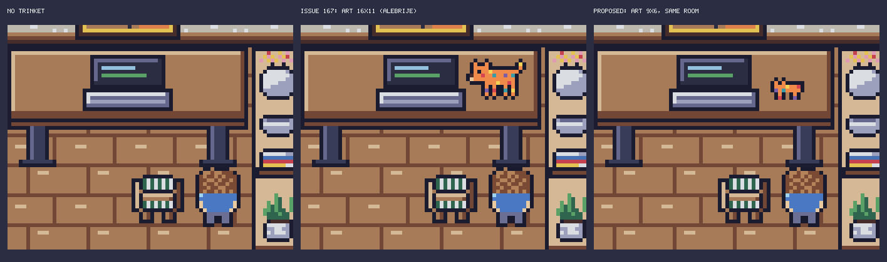

## 3. Size policy
Scale. The room is 16 px to a foot, so **1 px is 0.75 inch**. Two precedents set how to read it: the mug (above) is drawn about 1.3 times honest, and the player is 16 px for 5.5 feet, which is deliberately about three times honest (the player is a character, not a measure). So **compare a trinket with the furniture and the mug, never with the player**.

Rules.
- The drawing lives in a centred box, **cell columns 3 to 12 and rows 5 to 12** (at most 10 wide by 8 tall), including the 1 px ink outline. Everything else in the cell is transparent.
- **The foot is cell row 12**: the lowest opaque row of every trinket is row 12 (a thing standing on a surface). Nothing floats.
- The 8 px height cap is what lets every item fit a bookshelf cubby (section 7); the 10 px width cap is the gap on the nightstand (section 6).
- A floor of 5 px on the longest side, so nothing is a dot; the ceiling is the cap. Where honest size is below the floor the item is drawn at the floor (so it is overstated), and where it is above the cap the cap wins (understated).
- Palette only, light from the top left, 1 px outline, no text (art-style.md).

| Item | Typical real size | Honest at 1.3x | Box in the cell (w x h) | Step |
|---|---|---|---|---|
| Worry doll | 1.5 in tall | 3 px | 4 x 5 (floor) | S |
| Painted goose egg | 3.5 in tall | 6 px | 5 x 6 | S |
| Jaw harp | 3 in | 5 px | 5 x 6 | S |
| Finger skateboard | 3.5 in long | 6 px | 7 x 4 (wheels show) | M |
| Harmonica | 4 in long | 7 px | 8 x 4 | M |
| Alebrije | 4 in long, 3 in tall | 7 x 5 | 9 x 6 | M |
| Kalimba | 5 in | 9 x 6 | 9 x 6 | M |
| Raccoon in a can | 4.5 in tall | 8 px | 6 x 8 | M |
| Little telescope | 8 in on a small stand | 14 px | 10 x 8 (cap) | L |
| Mini keyboard | 11 in long | 19 px | 10 x 5 (cap, understated) | L |

Steps: **S** is 5 to 6 px on the long side, **M** 7 to 9, **L** 10. The steps follow real size, with two stated exceptions to "honest at 1.3x": the alebrije is drawn above its honest 7 x 5 (9 x 6) because a head, four legs and a tail need that many pixels to read as an animal, and the mini keyboard is the one thing the cap makes smaller than real. Within a step the order is not strict (the kalimba is 9 x 6, as honest). The doll is the smallest thing in the room; the telescope and the keyboard are the longest.

Mockup 02: the mug, the player, then six items in 167's size (top) and in the proposed size (bottom). The proposed ones are stand-ins; the sizes are what the policy says.

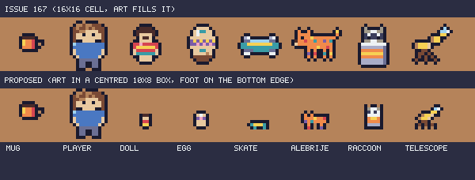

**Art rule for the checks.** A test (replacing 167's "rows 0 and 15 empty" check) reads each trinket and instrument sprite and fails if any opaque pixel is outside cols 3 to 12, rows 5 to 12, or if the lowest opaque row is not 12.

## 4. One cell, many places
Every place uses the same 16x16 cell, so the engine rule `fits` (sprite size equals slot area size) is unchanged and any item goes in any slot. The slot area is placed so that **the foot lands where the place wants it**: area x = (the place's centre x) - 8 (so the box's centre, between cols 7 and 8, is on it), area y = (the place's foot y) - 12. The place table (section 6) is exactly those two numbers per place.

Draw order is the existing rule: props sort by the bottom edge of the piece they sit on, so a prop draws over its piece and in step with the player. The slot area may reach above its piece (a negative `at`, which `tilemap.ts` allows: it only adds `at` to the piece's top left); the rows outside the art box are transparent.

## 5. Examine and the close-up card

### 5.1 The action
- Task `examine-<slot id>` on the piece that holds the slot, name "Examine trinket" with `itemWord: "trinket"` so it reads "Examine alebrije" (issue 149 made `taskName` and `itemWord`, but `Decor.taskName` reads the item through `liveSlot`, which also hides a task unless the item is live, and the prompt box draws `item.prompt`, not `name`; so `taskName` must also accept `heldSlot`, and `game.ts` must hand the prompt box a copy of the task whose `prompt` is the item-aware text, as it already does for the progress label's `name`). No points, `duration` 0, `cooldown` 0, always a quiet end (`completed: false, quiet: true`, like the swap list), never counted in the "every task" achievement (`achievements/feature.ts` builds that set and excludes only `decorSlot`, `delivery` and `scroll-photos` tasks, so **it must also exclude the examine tasks and `examine-cubbies`**, which end quietly and could never be completed; otherwise Completionist becomes impossible), and the clock stands still only while the card is open (`holdsClock`).
- **Only offered when the slot holds an item**: the mirror of the swap task's rule. A new `Interactable.heldSlot` (like `decorSlot` and `liveSlot`) is checked where `Game` sets `interaction.hidden`, so a fresh game shows nothing new and an empty place has no Examine.
- **Where it appears**: at every trinket place that holds something: the desk's right corner, the nightstand, each shelf slot, the sill if built, and (through the scene's menu) each cubby. It is last but one in the Tab cycle, just before the swap task, which stays last.
- **Prompt text**: "Examine alebrije", at most 25 characters ("Examine" plus a `taskName` of at most 17 characters; the longest names are "finger skateboard" and "painted goose egg"). Measured with `promptSize` with a `<2/9>` choice: "Examine little telescope" (24 characters) is 194 px wide and "Examine finger skateboard" (25) is 200 px, so both fit the 224 px view and the 320 px view.
- Optional, small, and my recommendation (decision d6): **the prompt only appears where the item is**. Today a task is offered from every tile of its piece, so Examine on the 4-tile desk would show anywhere along it. A slot task's zone narrows to the piece tile that contains the slot's centre x: the desk's col 9 (stand at col 9, row 3, face up), the nightstand's col 14, each shelf slot's own column. `Decor.swapProblems` would then check that the zone is a subset of the piece's tiles, not all of them. The swap task can use the same zone.

### 5.2 The card
It is an overlay activity of its own (`activities/examine.ts`, type `examine`, like `swap-decor`): it draws over the live view, does not switch the view, and so is laid out for 320x192 and for 224x208 from the live size.

Contents, from the item's data (nothing new is stored): the close-up sprite, `name`, the `FROM:` line (`item.from`, for example `FROM: A PACKAGE`), and `item.note` (at most 80 characters, as `NOTE_MAX` says). It has no points, counters, "1 of N" or "new".

Layout, measured (the dialog's look: 1 px ink border, paper fill, ink text; the room behind is dimmed by `rgba(26, 26, 46, 0.72)`):
- **320 x 192** (mockups 05 and 07): card at (12, 22), 296 x 164, below the HUD chips. Sprite field 148 x 148 at (20, 30): a 2 px ink border around a `night` square holding the 48x48 sprite at 3x, so 144 x 144 at (22, 32). Text column from x 178 to 300 (122 px, 20 characters a line): name at y 32, `FROM:` line at y 42 in `dusk`, the note from y 60 at a 9 px pitch (a full 80 characters is 4 or 5 lines, ending near y 105, inside the field; a word longer than the line would have to wrap, none in the notes is). The blinking close arrow of the dialog box sits at the card's bottom right.
- **224 x 208** (mockup 06): card at (4, 16), 216 x 190. The sprite field at (38, 19), 148 x 148, centred. Name at y 170 with the `FROM:` line right-aligned on the same row, the note from y 179 at 9 px (three lines of 33 characters, ending y 204, inside the card, which ends y 206). An 80-character note is three lines here; checked with a 71-character note and the 58-character 167 note.
- The sprite scale is "the largest whole number that fits with the note": 3x in both views.
- **Closing**: E, Esc, or a tap anywhere (`tapTargets` returns the whole screen). It returns to exactly the room it came from: no push-in, no fade, nothing that `reduced-motion` has to handle.
- No sound of its own in the first build (the sound feature can add a cue named `examine` later).

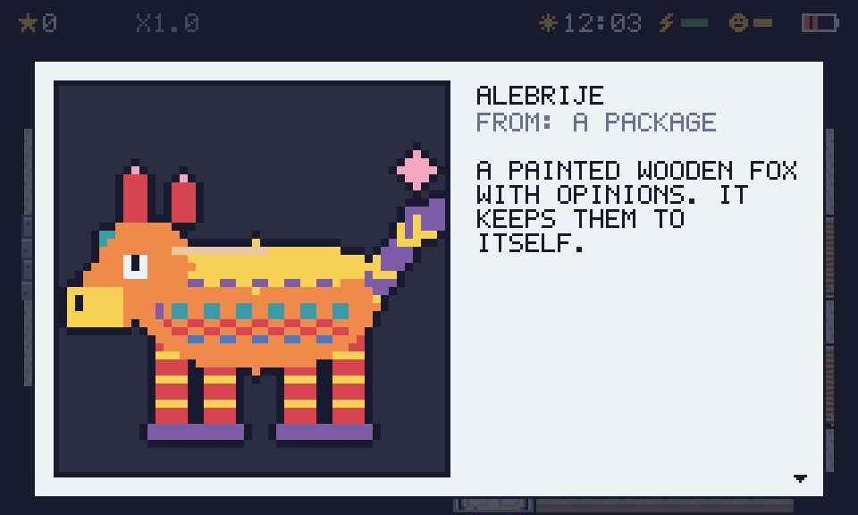
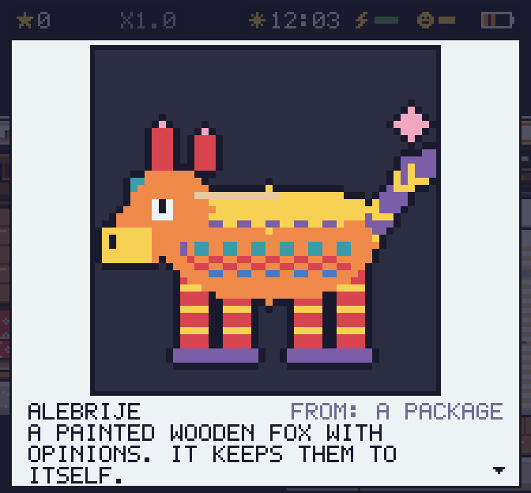
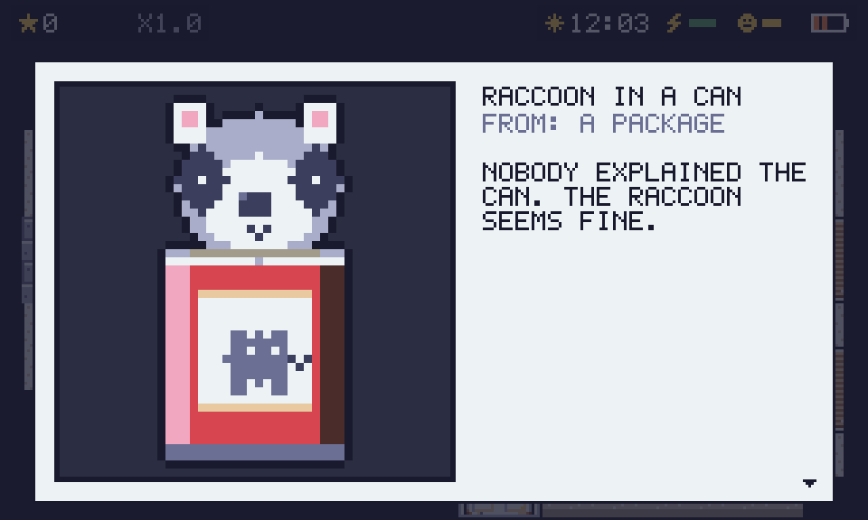

### 5.3 The close-up art
48 x 48 (3 x 3 tiles), one per item, named `<item sprite>-close` (`trinket-alebrije-close`): a convention, not a data field, with a test that every trinket and instrument has one and that its size is 48 x 48. A whole-tile size means the sprite pipeline needs no exception (only `icon-*` may be off the grid). The close-up is a detailed redraw of the same object (painted pattern, wheels, label shapes), not the small sprite scaled up; at 3x its pixels are chunkier than the room's but far finer than the zoomed art in `art-zoom` (which goes to 8x), so the pixel feel is kept. It is also where the real object's detail goes, which is why reference photos (d5) matter for the close-ups and not for the 6 to 10 px room sprites. No text in the art (a label is shapes). The two close-ups in the mockups are stand-ins that show the level of detail meant, not the final drawings.

## 6. Where trinkets can go: an audit against the real maps and sprites
All coordinates are abs pixels in the main room (304 x 160). "Cell" is the slot's 16x16 area; "foot" is where the art's bottom row lands. Pictures: 03 (the room with every place used, at the real size), 04 (each place at 8x), 11 (phone view at the desk).

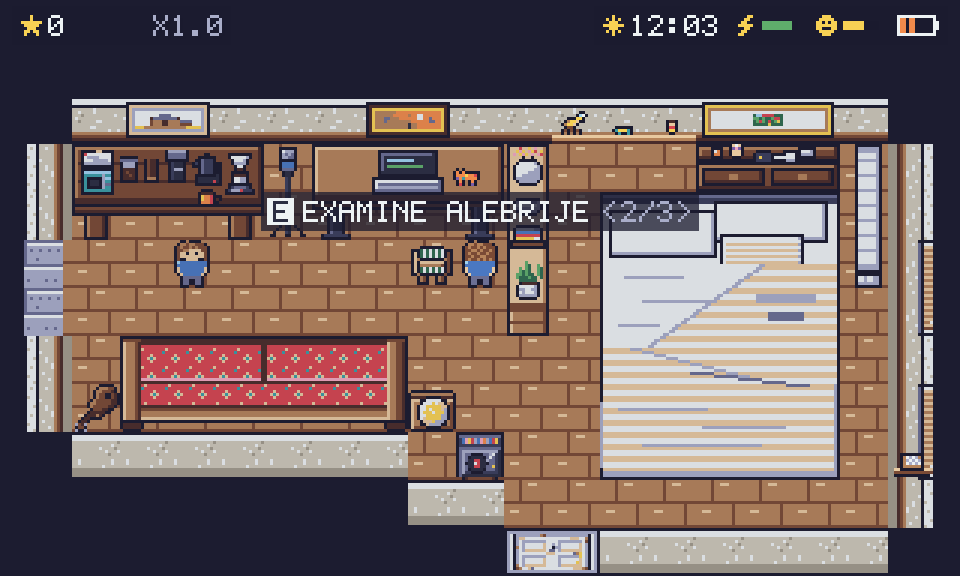
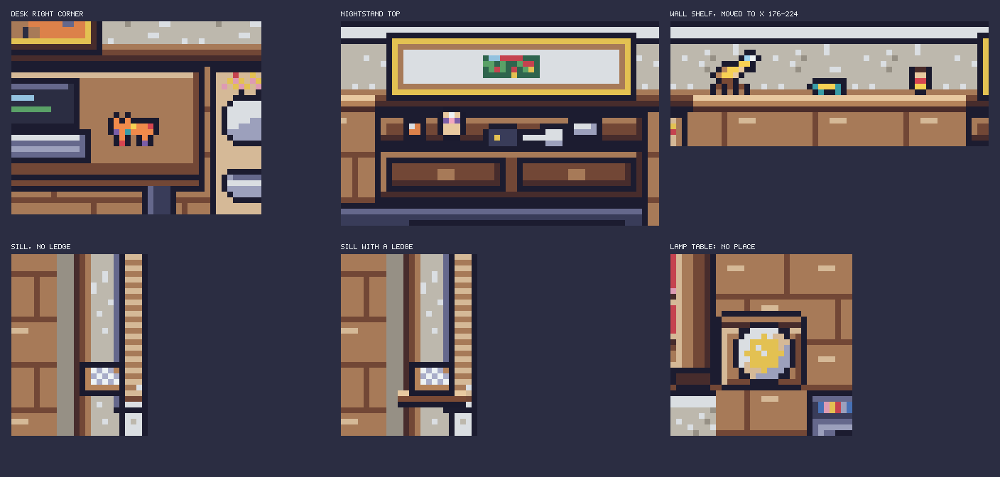
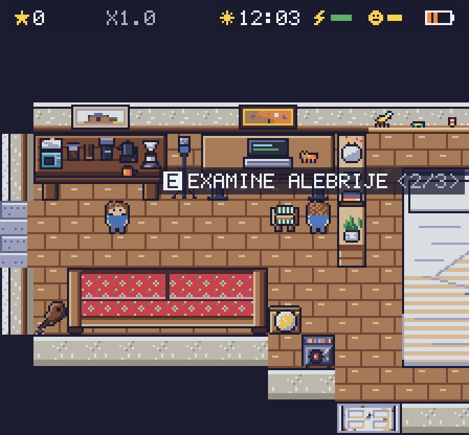

| Place | Verdict | Slot cell (x, y) | Foot (centre x, y) | What it overlaps and why it is clear |
|---|---|---|---|---|
| **Desk, right corner** | **Good** (as built) | `trinket-desk` (140, 17), unchanged from 167 | (148, 29) | The desk sprite (96, 16, 64x32) has bare tan at local x 44 to 61, y 2 to 16 (abs 140 to 157, 18 to 32): checked row by row; the laptop and monitor end at local x 43. The art box is abs x 143 to 152, y 22 to 29, entirely on tan; the front lip starts at abs y 33. The seated pose `type-desk` is abs (128, 32) to (144, 64): it starts below the box (which ends at y 29) and its x range ends at 143, where the box starts; props sort at the desk's bottom edge (48), the pose at 64, so the seated player is in front. Stand at (9, 3) facing up. No task spot under it (the desk is used from row 3). The left corner (local x 2 to 19) stays free for desk clutter (issue 042). |
| **Nightstand top** | **Good for one small item** | new `trinket-night` (230, 8) | (238, 20) | The nightstand (224, 16, 48x16) top is a 4 px strip (abs y 17 to 20). Already on it: a jar at local x 5 to 8 (abs 229 to 232), the phone charger prop (cell (242, 16), opaque abs x 243 to 257, y 18 to 22), a white box at local 34 to 39 and a tan one at 41 to 46. The free gap is **abs x 233 to 242, 10 px**, so an item up to 10 wide just fits and a 9 or 10 wide item (alebrije, kalimba, telescope, mini keyboard) touches its neighbours; the egg, doll, jaw harp, skateboard, raccoon fit with room. The box is abs y 13 to 20 at most; the painting over the bed (cell (224, 0), frame abs y 2 to 13) ends at 13, so an 8 tall item (top row 13) overlaps the frame's bottom ink row by 1 px, which reads as standing in front of it, and items of 7 or less clear it. Props sort at the nightstand's bottom (32); the bed starts at y 32, no overlap. Stand at (13, 1) facing east (the only reachable tile of the piece). It is the busiest 4 px in the room: one item looks like part of the clutter (mockup 04, top middle), which suits a nightstand. The prop id must not be `prop-nightstand` (the phone's scenery id). |
| **Wall shelf (issue 169)** | **Very good** | 169's three slots at x 160, 176, 192 (y 0) move to **x 176, 192, 208** (decision d9) | (184, 12), (200, 12), (216, 12) | The wall row (`wall-back`) is a 4 px lit top (y 0 to 3), plaster (4 to 11) and a baseboard (12 to 15). A plank over the baseboard at y 13 to 15 puts the foot at y 12 and the box at y 5 to 12, clear of the lit top, so every item (8 tall at most) fits with room above. Why x 176 to 224: the three stand tiles (11, 1), (12, 1) and (13, 1) are all floor and face north at one slot each. The first column of 169's design (x 160) is above the bookshelf (col 10, rows 1 to 4), which no one can stand under, so its item could never be examined or changed by facing it. x 224 is where the painting over the bed begins, so cols 11 to 13 are the last three free wall tiles that can be reached. |
| **Window sill, lower (east wall)** | **Poor; needs new window art; small items only** | `sill-window` (288, 112), as 169 has it | (296, 124) | The windows are drawn edge-on: only local x 10 to 15 (abs 298 to 303) is glass, and abs 288 to 297 is the wall's side face and shadow. The art box (abs x 291 to 300) straddles wall and glass, with no surface under it (mockup 04, the two bottom left panels: the item floats on the wall without a ledge; with a drawn 12x2 ledge it sits, but the ledge is new art). So the sill works only if the lower window is redrawn with a ledge (2 window sprites, open and closed), and the piece needs its own name (`w` and `W` are different map letters, but both pieces are named "window and blinds" and `swapProblems` finds a piece by name). Stand at (17, 7) facing east. I would build it last or not at all (decision d7). |
| **Lamp table (beside the lamp)** | **No place** | | | `lamp-table` (and every lamp that goes in its slot) is a 16x16 table with the lamp filling it: the lamp pool is cols 3 to 13, rows 5 to 13 and the rim is 1 to 2 px, so there is no free pixel. Putting a trinket on it would hide the lamp. The floor to its east, (9, 6), is walkable (the record stand can also be reached from (10, 7)), so widening the table to 2 tiles would not seal anything, but it makes the lamp slot 32x16 and all four lamps would be redrawn: large, for one place. Recommendation: drop it (decision d8). |
| **Bookshelf top** | **Not a place** | | | The top of the cube bookshelf (160, 16, 16x64) is already full (vase, bowl, books, then the plant prop at (160, 52)); the cubbies are handled by the scene instead (section 7). |
| **Dining table, sofa, record stand, floor** | No | | | The table is full (and has the mug prop and the coffee gear of issue 168), the sofa has the poses over it, the others are in walking lanes. Unchanged from the earlier audit. |

So there are three good places in the room (desk corner, nightstand, shelf) plus the cubbies, one poor (sill), and none at the lamp. For d2: **three places plus the cubbies**, not five.

## 7. The bookshelf cubby scene

### 7.1 What the player does
- The task `examine-cubbies` on the cube bookshelf, **"Examine bookshelf"**. It is offered once at least one trinket or instrument is owned (a dead end before that would be a nag). It is in the Tab cycle with the shelf's other tasks (water the plant, sort records, change the plant, change clothes), after them.
- It opens a **dedicated activity** (`cubbies`), not a cutscene view: a cutscene cannot take Left and Right or draw a cursor (the reason 117 made the gallery its own activity). It draws a composed picture: a **row of four cubbies**, books in each, a trinket where one is displayed, a butter cursor frame on the highlighted cubby, a name panel and a hint line. Mockups: 08 (wide), 09 (phone), 10 (the menu open, wide), 12 (the menu open, phone, a long note).
- **Move**: Left and Right between cubbies (stop at the ends, as the gallery does). Touch: tap a cubby to highlight it, tap it again to open (the 117 rule); the cubbies are 48 or 64 px square, so a thumb lands.
- **E on a cubby** opens a menu (the existing dialog choice menu, already tappable): for a cubby with a trinket, `EXAMINE`, `DISPLAY TRINKET`, `BACK`; for an empty one, `DISPLAY TRINKET`, `BACK`. If nothing spare is owned an empty cubby has no menu and the hint omits E. `EXAMINE` opens the card of section 5 as a child activity over the scene and Esc returns to the scene. `DISPLAY TRINKET` opens the swap list for that cubby (the existing `SwapDecorActivity`, with its NOTHING row for taking the item down), also as a child; the preview shows in the scene because the scene reads `Decor.lookAt` each frame.
- **Placing and taking**: placing is the swap list's E; taking down is its NOTHING row. The item goes to the inventory (`Decor.inventory`, issue 073), as for every slot. A trinket is shown in one place only (issue 073's rule): putting the alebrije in a cubby takes it from the desk, with the swap list's existing wording (`SWAPS WITH` and `GOES TO THE INVENTORY`).
- **Leave**: Esc, or the hint's key, returns to the room. It pays nothing and holds the clock (`holdsClock`), like the swap list; the activity ends quietly.

### 7.2 The picture
The cubbies are drawn at room scale and shown zoomed, so the books, the shelf and the trinket share one pixel size (as the art zoom does): a cubby is a 16x16 sprite, 4 of them side by side, shown at **4x on 320x192** (64 px each, a row of 256 at x 32 to 288, y 34 to 98, in a 5 px oak frame) and **3x on 224x208** (48 px each, a row of 192 at x 16 to 208, y 50 to 98). 5x would be 320 wide, and 4x is 256 (does not fit 224), so the scale is the largest whole number that fits the row with a margin, the 117 rule. The view is not switched (`showsPicture` stays false), so the phone keeps its 224x208 view and its own HUD band; the layout is a pure function of the live size (`cubbyLayout(view)`), tested without a canvas, like `gridLayout` in `reel/gallery.ts` (the sofa scene's layout).
- **Name panel** under the row: the dialog frame, the item's name in ink, its note in `dusk` (an empty cubby just says EMPTY, with no note and no hint of what to do). At 320x192 it is at (16, 118), 288 wide; at 224x208 it is at (16, 112), 192 wide.
- **Hint line** at the foot (the menu and the swap list are modal and cover it while open: the swap list is a box of about 79 px along the bottom, so it also covers the name panel, while the cubby row stays visible above it, which is what shows the preview; mockups 10 and 12 show the menu over the hint line): `LEFT RIGHT: CUBBY   E: OPEN   ESC: BACK` (`E: DISPLAY` on an empty one), from `hintLine`, so touch gets its own words; on the phone it wraps to two lines.
- **Books.** A cubby is 16x16 with an oak frame: interior cols 2 to 13, rows 2 to 12. Each of the four has a different small set of books drawn in the part the trinket does not use: a flat stack of two books (rows 11 and 12, a 1 px ink line above it at row 10) and one or two leaning books at cols 2 and 3. The **pocket for the trinket is cols 4 to 13, rows 2 to 9** and stays plain back wall: that is exactly the size cap of section 3 (10 wide, 8 tall), so every item fits every cubby, and a test checks the pocket is plain back wall in the four sprites.
- **Where the trinket goes.** The item's own 16x16 cell is drawn at the cubby's origin plus (1, -3) in room pixels, so its box lands on the pocket and its foot (row 12) on cubby row 9, on the ink line above the stack. At 4x that is an offset of (4, -12) screen pixels; the cell rows outside the art box are transparent so reaching above the cubby shows nothing.
- Four cubby interiors are the only new room-scale art of this scene (4 sprites, 16x16). The frame, the cursor and the panel are drawn with rectangles.

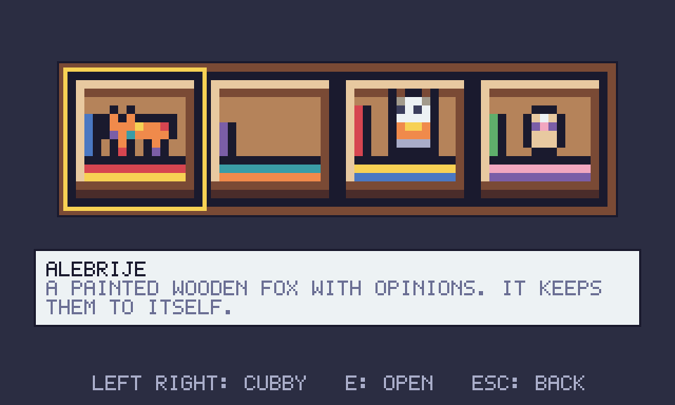
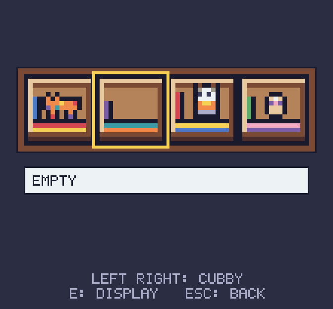
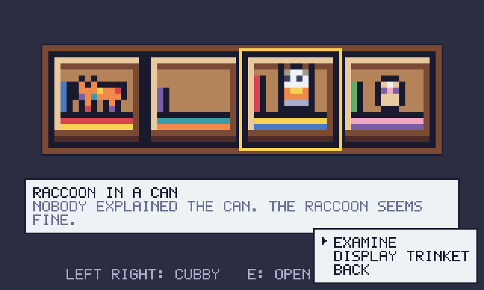
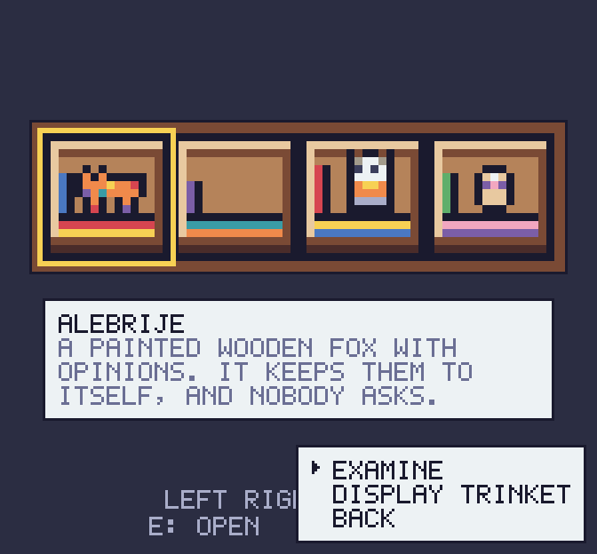

### 7.3 Slots
Four decor slots `trinket-cubby-1` to `trinket-cubby-4`: room main, `offMap: true` (built in issue 152 for the worn outfit: nothing drawn at the area, it is only the size items must match), area `(0, 0, 16, 16)`, `name` "CUBBY 1" to "CUBBY 4" and `where` "IN THE BOOKSHELF" (the swap list shows them), kinds `trinket` and `instrument`, no default, **no `object`** (so no map swap task and no `swapProblems` entry; the scene starts the swap list itself). `decor.test.ts` pins the list of off-map slots to `["worn"]`, so that line changes to name the four cubby slots (the exemption itself is already there).

### 7.4 Why a row of four
Marc's description is "its four cubbies" and the floor plan draws the shelf 1 tile by 4 (16 x 64, long along the wall), so a row of four fits, and a 4x1 strip of 16x16 interiors is the cheapest composition. The old `view-bookshelf` (kept, undrawn) shows the same object as a stack of four down a tall picture. **I do not know how the real shelf's four cubbies are arranged** (a row, or two by two) and this is a question for Marc (decision d11). If it is two by two, the layout becomes 2x2 at 4x (128 x 128) on both views with the panel beside it on the wide view; the cubby sprites, slots, cursor and menu do not change.

### 7.5 Precedents reused
- Issue 111 (`side-project-room.ts`, `composed-views.ts`): the idea of composing a picture at a different scale, and a pure compose function the tests call. The cubby picture is not made from the room's pieces, so the registry of composed pictures is not used; only the pure-function-plus-recording-drawer test style is.
- Issue 117 (the sofa scene, `activities/reel.ts`): a dedicated activity that lays itself out from a pure layout function, offers `tapTargets`, runs another activity as its `child` (the ad encounter there, the swap list and the card here), and chooses the largest whole-number scale that fits. The hint line and the "tap again to open" rule are copied.
- The art close-up zoom (`art-pieces.ts`, `view-zoom.ts`): whole-number scales of a 320 x 192 picture. It is a cutscene (not interactive); the card and the scene reuse only its idea that a close-up is a magnified look and not a different picture.

## 8. What issue 167 keeps and what changes
| 167 piece | Fate |
|---|---|
| `DecorSlot` `trinket-desk` (140, 17, 16x16), kinds, object, no default | Kept unchanged (the foot at (148, 29) lands on the tan, section 6). |
| `PropDef` on `D` at (44, 1) | Kept unchanged. |
| `trinket` and `instrument` kinds, the empty-slot option of 151 | Kept: the NOTHING row is how a cubby or a shelf slot is cleared. |
| `swap-trinket-desk` and `SWAP_PROMPT.trinket` | Kept; the prompt becomes "Display trinket" (issue 174, d2), the same for adding and changing. |
| The ten items: ids, names, notes, `from`, kind | Kept verbatim (the notes are good and already at most 80 characters). The only data addition is `taskName` per item (lowercase, at most 20 characters: "alebrije", "little telescope", "finger skateboard", "painted goose egg", "worry doll", "raccoon in a can", "harmonica", "kalimba", "jaw harp", "mini keyboard"). |
| Gifts `gift-day-81` to `gift-day-108` | Kept. |
| The ten 16x16 sprites | **Replaced**: redrawn into the box of section 3 under the same file names, so no data line changes. |
| `decor-trinkets.test.ts` ("rows 0 and 15 empty") | Replaced by the box and foot check of section 3. |
| 167 as a branch | Do not merge its pictures. Build stage A of section 13 from it (decision d12). |

## 9. Engine each piece needs
| Piece | Change | Size |
|---|---|---|
| Close-up sprites | A convention: `<sprite>-close`, 48x48, with a test over every trinket and instrument; a missing one makes the card fall back to the small sprite at 8x (so nothing breaks while art is missing). | S |
| Examine task and card | `achievements/feature.ts` excludes the examine tasks from "every task"; `Decor.taskName` accepts `heldSlot`; `activities/examine.ts` (`examine`, quiet end, `holdsClock`, `readsKeys`, `cancellable`, a whole-screen tap target) registered with `registerActivity`; one `Task` built per slot in `tasks.ts` like `SWAPS` (`examine-<slot>`, `heldSlot`, `itemWord`); `Interactable.heldSlot` and one line in `Game` where `interaction.hidden` is set; the prompt uses `Decor.taskName`. The card's layout is a pure function of the live view size, tested without a canvas. | M |
| Per-tile prompts (optional, d6) | A slot task's zones: the piece tiles that contain the slot's centre x; `swapProblems` accepts a subset. | S |
| New slots | `trinket-night` (nightstand, kinds as the desk, object "nightstand", prop on `N`); later the shelf slots (169) and four off-map cubby slots. Data lines in `decor-data.ts` and `apartment.ts`; tests pin the slot list (one line each). | S |
| Cubby scene | `activities/cubbies.ts` (`cubbies`), `cubbyLayout(view)` (pure), a drawer, `tapTargets`, children for the card and the swap list (the `child` pattern of `reel.ts`), the `examine-cubbies` task with a requirement that something is owned. | L |
| Text | Strings in `docs/text-review.md` (the new prompts, `EMPTY`, the hint line, `DISPLAY TRINKET`); `unsupportedChars` runs over them. | S |
| Pipeline | Nothing: 16x16 and 48x48 are whole tiles. | none |
| Golden frames | Unchanged by every stage (a fresh game owns no trinket and every new slot starts empty); stage C's prop has no sprite while empty. | none |

## 10. Art counts and sizes
| What | Count | Size | Stage |
|---|---|---|---|
| In-room trinket and instrument sprites (redraw of 167's) | 10 | 16x16 | A |
| Close-ups | 10 | 48x48 | B |
| Cubby interiors | 4 | 16x16 | E |
| Wall shelf (issue 169) | 1 | 48x16 | D |
| Sill: the two window sprites with a ledge | 2 | 16x32 | F (optional) |

Nothing else: no nightstand redraw (the gap is already there), no lamp redraws.

## 11. Text
- Swap prompt: **"Display trinket"**, for adding and for changing (issue 174, d2). The menu in the scene says `DISPLAY TRINKET`.
- Examine prompt: **"Examine alebrije"** (the item's `taskName`), **"Examine bookshelf"** for the scene. No "the", as issue 174 asks.
- Card: the item name, `FROM: A PACKAGE`, the item's note. No title, no counts, no "new", no key hint (the dialog's blinking arrow is the cue).
- Scene: the name and note of the highlighted cubby, or `EMPTY`; the hint line from `hintLine`.
- Everything in capitals and basic punctuation (`unsupportedChars`), no real brands or recent artists in names, notes or art.

## 12. Quiet-collecting risks
- A displayed shelf invites completion. Rules: no counter anywhere (the card has none, the scene has none, the THINGS page has none); no achievement for filling the cubbies or owning a number of items; no wording with a nudge (an empty cubby says only EMPTY); no timed or limited gifts (the gifts are the existing every-third-day ones); nothing is ever lost or broken; swapping is free and undoable.
- Examine pays nothing and has no cooldown, so it cannot be farmed or ignored; it never appears for an empty place, so it cannot nag.
- The scene is offered only once something is owned, and an empty cubby with nothing spare to put in it offers nothing at all.
- The wall shelf and the sill are visible furniture: the shelf is empty at first (decision d1 of issue 169 asks whether it is in a fresh game); an empty plank is the one place a "you have nothing here" feeling could come from, so a shelf from the start is quiet only if nothing counts what is on it.
- Items in the cubbies are not extra: an item is shown in one place (issue 073), so filling the cubbies means emptying the desk. There is no "more space means more reward".

## 13. Stages (each independently releasable; main stays releasable)
Marc's rule: main must always be releasable, so half-finished stages stay on a feature branch until safe. Each stage below leaves a working game and a fresh game unchanged.

| Stage | What | Needs | Size | Releasable because |
|---|---|---|---|---|
| **A** | Finish 167 with small art: redraw the ten sprites into the box; the box and foot test; `taskName`s (and `taskName` reading `heldSlot`); "Display trinket" lands with issue 174. | 10 sprites | S | The desk corner shows small things; nothing else changes. |
| **B** | Examine and the card: `heldSlot`, the `examine` activity, the close-ups, per-tile zones (d6). | 10 close-ups | M | Works at the desk alone; an empty slot shows nothing. |
| **C** | The nightstand slot (230, 8) and its two tasks. | 0 art | S | One more place that behaves like the desk. |
| **D** | The wall shelf: slots at x 176, 192, 208 (issue 169 with d9). | 1 sprite (169) | M | Owned by issue 169; this design supplies the cell geometry. |
| **E** | The cubby scene: four off-map slots, `cubbyLayout`, the activity, the task. | 4 sprites | L | An optional extra task on the bookshelf, offered only when something is owned. |
| **F** | The sill, only if wanted (d7): window art with a ledge, two piece names. | 2 sprites | M | Last, optional. |

Order: A, B, C, then D and E in either order; F last. Stage A can be merged on its own as soon as the redraw is reviewed (the planner decides what happens to the unmerged 167 branch: d12).

## 14. Open questions
Beyond d1 to d5 (which this note does not answer), the issue file lists d6 to d12 with a recommended default each: per-tile prompts (d6), the sill (d7), the lamp table (d8), the shelf columns (d9), the close-up size (d10), how the real shelf's cubbies are laid out (d11) and what to do with the 167 branch (d12). Every number above assumes the recommended defaults, including d1 to d4 as recommended.

## 15. What was not checked
- Nothing was seen in a real browser; the frames come from the headless harness (the real game code, sprites and font, a software canvas). The time-of-day light, the glow and real animation were not part of these frames (all at 12:00).
- The new art is stand-in art made for the mockups; the real drawings may need the boxes nudged by a pixel.
- Touch behaviour of the scene and the card (taps, the hint wrapping) is laid out but not tried on a phone.
- The nightstand was looked at only by day and with the phone prop as it is drawn when nothing is charging.
- The real sizes of the objects are typical sizes for each kind, not measured.
- The real shelf's cubby arrangement (d11) is assumed to be a row of four.
- The mockups of places 03 and 04 draw the shelf at its moved columns (x 176 to 224), not at 169's own. The mockups' PNG files are 3x enlargements of the real-size frames (04, 01 and 02 are sheets at their own scales).
